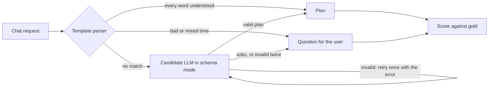

# R-1 Planner LLM: Research & Approach

Oct 28, 2026 · @Paul P · updated Nov 12, 2026 for **R-1b**, against `paul/r1b-planner-llm` @ `439b0d6` (`main` @ `44708a6` plus the R-1 and R-1b commits).

## TL;DR

R-1 picks the model for the planner's LLM slot. R-1b has **no budget**, so only free options are candidates: hosted free tiers and open models on our own GPUs. **No model is picked yet, because no candidate has been scored.** Everything needed to score them is built and tested. What's left is putting in the free keys and running two sets of runs: hosted from any machine, local on our GPUs (Plans A and B below).

- **Free hosted candidates:**
  - **Groq:** GPT-OSS 120B, GPT-OSS 20B, Qwen 3.8 27B.
  - **Gemini free tier:** 3.8 Flash, 3.5 Flash-Lite.
  - **OpenRouter `:free`:** Nemotron 3.5 Super VL, Gemma 4 31B, both quality only.
- **Local candidates (Ollama):** Qwen3.5 4B and 9B, Gemma 4 E4B and 12B.
- **Paid models are out:** Claude, GPT and paid Gemini stay in the script, but they never run without `--allow-paid`.
- **New decision rule, fixed before any scored run.** It replaces the Opus ceiling, which costs money. Over the 34 core requests that reach the LLM, 5 runs each:
  1. zero unsafe results (or the fewest);
  2. at least 80% correct;
  3. p95 under 5 s.

  The best free hosted model that passes wins. The best local one becomes the offline fallback.
- **Built on the branch:**
  - the benchmark on today's 8 tools;
  - the reply schema and prompt;
  - Groq, Gemini, OpenRouter and Ollama adapters;
  - `VIBE_PLANNER_LLM`, which wires the chosen model into the chat route;
  - a guard that asks before cutting at a time the user didn't give.

  Tests: 1242 passed, 6 skipped. The guard and the floor rule are new.
- **Template parser:** unchanged in scope. It takes 30 of the 64 core requests and is wrong on none (script output, no model involved).

## What R-1 asks for

R-1 picks the LLM behind the planner (F-05). It was due Nov 3 and carried over to Sprint 4 as **R-1b** (Trello card "R-1b Run the planner LLM comparison + wire LlmPlanner into F-05").

**R-1b's scope:** rebase the R-1 work onto `main` and open the PR. Then:
- run the comparison with free candidates only;
- add the decision row, and close "Which LLM for the planner" in `docs/ARCHITECTURE.md`;
- pass the chosen `LlmPlanner` to `plan_request(..., llm=...)`;
- flag LLM-invented cut ranges for confirmation.

**Exit check (what "done" means):**

- [x] A script that prints, per candidate, plan validity, correctness, unsafe and over-asked counts, latency, and VRAM and speed for local models: `python -m vibe.agent.bench report`.
- [ ] Its output from real runs → a decisions-log row in `docs/ARCHITECTURE.md`, proposed to the team first. Draft below.
- [x] The chosen `LlmPlanner` reaches `plan_request`: `VIBE_PLANNER_LLM=<candidate>` (see "What's built").
- [x] LLM-invented cut ranges are asked about before anything is cut (`agent/grounding.py`).
- [ ] A request the templates don't take gets a valid plan from the chosen model. This waits on the runs.
- [ ] The planner candidates updated in `README.md` and `docs/ARCHITECTURE.md`, and the handoff entry written.

**Project rules that apply:** every number comes from a script, with the hardware stated. Free tiers' terms change, so each was read on the date given, and a run should check them again.

## What the planner has to do

The planner turns one chat request into one JSON plan, and plain code runs it through the toolbox. The LLM never touches pixels, audio or track ids. So R-1 tests "does the model write a correct plan in one shot", not chat quality or agentic tool use.

**Fixed by the repo** (`docs/ARCHITECTURE.md`, section 2; D-006 and D-016 are still Proposed):

- One LLM call per request writes the whole plan. At Knight Hacks, one plan took 2 to 7 s; calling tools step by step took over 2 minutes.
- An invalid plan is retried once with the error, then the agent asks the user. It never guesses (`plan_with_llm` in `agent/planner.py`).
- The LLM sees text only: the request and the tool list. D-017 allows text to go to a cloud model.
- The LLM is never on the live per-frame path. It runs once when a standing rule is set.

**The 8 tools it plans with today** (`toolbox/registry.py`): `find_objects`, `resolve_time`, `add_mask`, `cut_range`, `keep_range`, `mute`, `unmute` and `denoise`. The reply schema and the prompt are built from the registry, so a new tool reaches the LLM without editing `llm.py`.

**Two behaviours R-1b added:**

- **The LLM can ask on purpose.** The reply is `{"clarify": "<question>" | null, "calls": [...]}`, so asking and failing are different outcomes.
- **Cuts at a time nobody gave are confirmed first.** A cut loses footage, so an LLM plan may only cut or keep at times the user wrote ("0:10 to 0:20", "after 1:30") or phrases they said ("the last third").
  - Anything else becomes a question with the exact words that do it, for example: "I'd cut 0:30 to 0:50, but you didn't give that time, so it's my guess. Is it right? To go ahead, say 'cut 0:30 to 0:50'."
  - The template parser takes that sentence as it is. Templates are exempt, because they only use what was written.
  - The benchmark scores the model's own plan, so an invented cut still counts as `unsafe`, and it reports how often the guard would have fired.

## Finding: the request set (resolved)

On Nov 2 the shared request set couldn't compare models. Every request that reached the LLM expected a question, and a broken model could score perfectly by failing twice. Both causes are fixed: the `clarify` reply exists, and `backend/tests/agent/requests_llm.json` adds requests that reach the LLM and expect plans.

**The set now** (script output at `439b0d6`, Linux cloud container, Python 3.12.3, no model involved):

| Route | Template set (`requests_draft.json`) | LLM set (`requests_llm.json`) |
| --- | --- | --- |
| Template parser returns a plan | 21 | 0 |
| Parser asks by itself (bad or mixed time) | 9 | 0 |
| **Reaches the LLM, expects a plan** | 0 | **17** |
| **Reaches the LLM, expects a question** | 12 | **5** |
| Extras (tools that don't exist yet, scored but not decided on) | 0 | 9 |

So **34 core requests reach the LLM, 17 expecting a plan and 17 a question**, and the decision is made on those. The templates take the other 30 core requests and are wrong on 0 of them.

R-1b's changes to the set:
- **Out:** "remove the background noise", because a template takes it now.
- **In:** six requests the templates miss, for the new tools:
  - "clean up the hiss in the first half";
  - "get rid of the fan hum";
  - "make the audio less noisy";
  - "turn the audio back on after 1:00";
  - "bring the sound back";
  - "keep only the part from one minute to the end".

**Jean (F-09)** should still review the gold results, because the same person wrote the requests and the answers.

## Candidate shortlist (free only)

Every candidate costs $0 per call. The real costs are rate limits for hosted tiers, and GPU time and memory for local models. All were read from the providers' own pages on **Nov 12, 2026**. The same facts are in `FREE_TIERS_AS_OF` in `backend/src/vibe/agent/bench/candidates.py`.

| Candidate (bench name) | Model ID | Free limits, as published | Notes |
| --- | --- | --- | --- |
| `groq-gpt-oss-120b` | `openai/gpt-oss-120b` | 30 RPM, 1K requests/day, 8K tokens/min, 200K tokens/day | Strict JSON schema supported. Lowest reasoning effort is `low` |
| `groq-gpt-oss-20b` | `openai/gpt-oss-20b` | Same | Same |
| `groq-qwen3.8-27b` | `qwen/qwen3.8-27b` | Same | Strict JSON schema supported. Reasoning can be off (`none`) |
| `gemini-3.8-flash` | `gemini-3.8-flash` | Not published: shown per project in AI Studio | Free tier. **Free-tier content is used to improve Google's products** |
| `gemini-3.5-flash-lite` | `gemini-3.5-flash-lite` | Same | Same |
| `openrouter-nemotron-3.5-super-vl` | `nvidia/nemotron-3.5-super-vl:free` | Daily cap per account, from `GET /api/v1/key` | Lists `structured_outputs`. **Quality only**: the proxy hop makes latency not comparable |
| `openrouter-gemma-4-31b` | `google/gemma-4-31b-it:free` | Same | Lists `response_format` only, so schema adherence may be best-effort. Quality only |
| `qwen3.5-4b` | Ollama `qwen3.5:4b` | Our hardware | 3.3 GB download. Runs on every team GPU |
| `qwen3.5-9b` | Ollama `qwen3.5:9b` | Our hardware | 6.6 GB. 8 GB cards |
| `gemma4-e4b` | Ollama `gemma4:e4b` | Our hardware | 6.6 GB. 8 GB cards |
| `gemma4-12b` | Ollama `gemma4:12b` | Our hardware | 7.7 GB, so tight on an 8 GB card. Run it on 12 GB or more |

- **Groq's token limit is the binding one.** A call here is about 3.3K tokens, so `run` paces Groq to 2 requests a minute by default. That's an estimate: the core prompt and schema are 13.3K characters, at about 4 characters per token.
- **Not free tiers we can use:**
  - Groq's other free models are speech, safety or guard models.
  - Gemini 4 Carbon and Argon aren't on the free tier.
  - Four more OpenRouter `:free` models list structured outputs: ERNIE 5.5 Flash preview, LFM 3 1.7B, LFM 2.5 2.6B and dots-3 note preview. They're previews or very small, so they're left out. Add one to `candidates.py` if a teammate wants it.
- **Paid, not run (no budget):** Claude Opus, Sonnet and Haiku 5.5, and GPT-5.6 Terra. They stay in `candidates.py` with Nov 1 prices, refused without `--allow-paid`.

## Team hardware and where each local model runs

As reported on Oct 28. Only Paul's card has been checked since (`nvidia-smi` on Nov 1: RTX 4060 Ti, 8188 MiB). "Can run" compares Ollama's download size with the card's memory. None of these has run yet.

| Teammate | GPU or memory | OS | Local candidates it can run |
| --- | --- | --- | --- |
| Pablo H. | Apple M5 Pro, 64 GB unified memory | macOS | All four |
| Nickolas G. | RTX PRO 2000 Blackwell, 16 GB | Windows 11 | All four |
| Alex W. | RTX 5070: 12 GB desktop or 8 GB laptop, unconfirmed | Not given | All four if 12 GB; 4B, 9B and E4B if 8 GB |
| Paul P. | RTX 4060 Ti, 8 GB | Windows 11 | Qwen3.5-4B, Qwen3.5-9B, Gemma 4 E4B |
| Jonathan S. | RTX 5060 Ti, 8 GB | Windows | Qwen3.5-4B, Qwen3.5-9B, Gemma 4 E4B |
| Luis P. | RTX 4050 Laptop, 6 GB | Windows 11 | Qwen3.5-4B |
| Paul A. | RTX 3050, 4 GB | Windows 11 | Qwen3.5-4B, with a short context |
| Chris | Integrated graphics | Windows 11 | Qwen3.5-4B on the CPU, slowly |

- **Compare speed within one machine only,** and label every result with its hardware. Pablo's runs use Metal, not CUDA.
- **Blackwell cards need CUDA 12.8+ builds:** Nickolas's RTX PRO 2000, the 5060 Ti and Alex's 5070.
- **A resident local planner takes VRAM the vision models need.** On an 8 GB card, a 9B planner leaves almost no room, so that's a cost of the local option, not just $0.

## How the comparison works

Score every candidate against a hand-written gold result for each request, 5 runs each, from one script. The script saves raw replies to JSONL in `outputs/r1-planner/` (gitignored), so re-scoring never costs another call.



**What the report prints, per candidate:**

- **Plan validity:** valid on the first try, and after the one retry.
- **Correctness:** plans are compared by what they do. Refs are followed, and `resolve_time` is evaluated on a 120 s clip, so a literal 0 to 10 s equals `resolve_time("first 10 seconds")`. A `keep_range` counts as the cuts it makes. Step names and independent order are ignored.
- **Unsafe** (a count): any of
  - a plan where it should have asked;
  - any cut the gold result doesn't have;
  - a mask that leaves visible what the gold result hides.
- **Over-asked:** a question where it should have planned.
- **Latency:** p50 and p95, with the first call reported separately, labelled with hardware and network.
- **Local models:** VRAM, load time and tokens per second.
- **Consistency:** the share of requests where all 5 runs agree.
- **Cut guard:** how often production would have held a plan back to confirm a cut.
- **Candidate zero:** the template parser alone, scored the same way.

**The decision rule** (R-1b, Nov 12, 2026, before any scored run; `backend/src/vibe/agent/bench/__init__.py`). Over the 34 core requests that reach the LLM, 5 runs each:

1. Zero `unsafe` results, or the fewest if no candidate has zero.
2. At least **80%** correct.
3. p95 latency under **5 s**, on the stated hardware and network.

- **Who's compared:** only free and local candidates that ran every one of those requests 5 times.
- **Winner:** of the free hosted candidates that pass every gate, the one with the most correct, then the lowest p95.
- **Offline fallback:** the local model that passes, or passes the most gates.
- **Quality-only candidates** (OpenRouter) can't pass the latency gate.
- **Extras** (requests for tools that don't exist yet) are reported but don't decide anything.

It replaces R-1's Oct 31 rule ("correct within 5 points of the Opus 5.5 ceiling"), because R-1b can't pay for Opus.

**The four questions left open on Nov 2, now decided:**

| Question | Decided |
| --- | --- |
| Do the gates cover all core requests or only those reaching the LLM? | Only those reaching the LLM (34) |
| Does a mask that leaves people visible count as `unsafe`? | Yes. Privacy edits fail closed (`CLAUDE.md`) |
| Is "cheapest" cached or uncached? | Moot: every candidate is free. Ties go to p95 |
| Do requests for future tools run in this pass? | Optional (`--set all`). They never decide anything |

**Fairness rules:**

- The same system prompt, few-shot examples and schema go to every candidate, with no few-shot example in the scored set.
- Each record carries a hash of the prompt and schema. The report leaves out results made with an older prompt and says how many, so a run spread over several days can't mix prompts.
- Each provider uses its native schema mode: OpenAI-compatible strict `json_schema` (Groq, OpenRouter), Gemini's `response_json_schema`, Ollama's `format` field.
- Reasoning is at the lowest setting each model allows:
  - GPT-OSS `low`;
  - Qwen 3.8 `none`;
  - Gemini thinking `minimal`;
  - Ollama `think: false`. Per Ollama's docs, models that can't turn thinking off use their lowest level.
- Sampling stays at each provider's default.
- A rate limit (HTTP 429) **stops** the run and keeps what's saved. A free tier's daily cap would otherwise be scored as the model failing. `--resume` picks up where it stopped.

## Plan A: test the free API keys

Hosted candidates can run from any machine. Their latency includes the network, so say which one with `--network`.

**1. Create the three keys**:

| Provider | Where | Notes |
| --- | --- | --- |
| Groq | [console.groq.com/keys](https://console.groq.com/keys) → create an API key | Free plan limits as in the table above |
| Gemini | [aistudio.google.com/apikey](https://aistudio.google.com/apikey) → create an API key | AI Studio creates a default Google Cloud project. **Don't link a billing account:** that moves the project to the paid Tier 1 |
| OpenRouter | [openrouter.ai/settings/keys](https://openrouter.ai/settings/keys) → create a key | Only the `:free` models run. Check today's allowance (below) |

**2. Put them in `.env` at the repo root.** It's gitignored, so never commit a key or paste one in chat.

```bash
cp .env.example .env
```

Fill in `GROQ_API_KEY=`, `GEMINI_API_KEY=` and `OPENROUTER_API_KEY=`, and leave the paid keys empty. For runs from a Claude cloud session, don't use `.env`. Claude asks for each key through the session's secure key form, and the network proxy adds the key to the requests.

**3. Install the SDKs** (once), from `backend/`:

```bash
uv sync --group llm
```

On Windows PowerShell, set UTF-8 output first, or a piped run can stop on a non-ASCII character:

```powershell
$env:PYTHONUTF8=1
```

**4. Preflight.** It checks each model exists and accepts the schema. It makes 2 calls per candidate, which count toward the limits.

```bash
uv run --group llm --env-file ../.env python -m vibe.agent.bench preflight --candidate groq-gpt-oss-120b --candidate groq-gpt-oss-20b --candidate groq-qwen3.8-27b --candidate gemini-3.8-flash --candidate gemini-3.5-flash-lite --candidate openrouter-nemotron-3.5-super-vl --candidate openrouter-gemma-4-31b
```

What to look for:

- **`core schema: accepted`** for each candidate, which is the one that matters.
- **A missing key fails clearly:**
  - `FAILED: KeyError: 'GROQ_API_KEY'` (OpenRouter shows its own key name);
  - Gemini says `No API key was provided`.
- **A rejected property named `$ref`:** set `WIRE_REF_KEY = "ref"` in `backend/src/vibe/agent/bench/run.py` for **all** candidates, before any scored run.
- **Extras schema rejected:** fine, extras don't decide anything.

**5. Scored runs:** the 34 requests that reach the LLM, 5 runs each. Run each candidate the same way, and run it again each day until it's complete. `--resume` skips results already saved, and a 429 stops it cleanly.

```bash
uv run --group llm --env-file ../.env python -m vibe.agent.bench run --candidate groq-gpt-oss-20b --set llm --runs 5 --resume --network "home Wi-Fi, Miami"
```

- **Groq:** paced to 2 requests a minute by default. The three Groq models have separate limits, so they can run side by side.
- **Gemini:** limits aren't published, so look at [AI Studio's rate-limit page](https://aistudio.google.com/rate-limit) for the project and pass `--rpm` to match.
- **OpenRouter:** check the daily allowance before a run:

  ```bash
  curl -s https://openrouter.ai/api/v1/key -H "Authorization: Bearer $OPENROUTER_API_KEY"
  ```

  The reply's `free_model_daily_requests` shows the limit and what's left today.

**How long it takes (an estimate, not a measurement).** One pass is 34 × 5 = 170 calls, plus retries. On Groq's 200K tokens a day, at about 3.5K tokens a call, that's about 57 calls a day per model, so **about 3 days per Groq model**. Gemini and OpenRouter depend on the project's and account's limits.

**6. Report** (no API calls), from `backend/`:

```bash
uv run python -m vibe.agent.bench report --detail
```

## Plan B: run the local models (Ollama)

Local runs measure our own hardware, so run them on the machine whose numbers you want, one model at a time, with other GPU apps closed. Assignments:
- **Paul (RTX 4060 Ti, 8 GB):** `qwen3.5-4b`, `qwen3.5-9b`, `gemma4-e4b`.
- **Nickolas (16 GB) or Pablo (Mac):** `gemma4-12b`, which is too tight for 8 GB. Pablo's numbers are Metal, labelled as such.
- **Optional:** Paul A. runs `qwen3.5-4b` on the 4 GB card, to show the low tier.

**1. Install Ollama.** On Windows PowerShell, the official installer:

```powershell
irm https://ollama.com/install.ps1 | iex
```

Or download it from [ollama.com/download/windows](https://ollama.com/download/windows). On a Mac, download it from ollama.com.

**2. Pull the models.** Download sizes are 3.3 GB, 6.6 GB and 6.6 GB:

```bash
ollama pull qwen3.5:4b
```

```bash
ollama pull qwen3.5:9b
```

```bash
ollama pull gemma4:e4b
```

**3. Check the model fits on the GPU.** Load it once, then look at the `PROCESSOR` column. It should say 100% GPU. If part of it runs on the CPU, its latency isn't comparable, so record that.

```bash
ollama run qwen3.5:9b "hello"
```

```bash
ollama ps
```

**4. Preflight**, from `backend/`. No keys are needed, and Ollama must be running.

```bash
uv run --group llm python -m vibe.agent.bench preflight --candidate qwen3.5-4b --candidate qwen3.5-9b --candidate gemma4-e4b
```

`FAILED: LlmError: ... Connection refused` means Ollama isn't running.

**5. Scored runs**, 5 runs of the 34 requests per model. The hardware is detected with `nvidia-smi`, and `--hardware` says it better.

```bash
uv run --group llm python -m vibe.agent.bench run --candidate qwen3.5-9b --set llm --runs 5 --network "local: Ollama on this machine" --hardware "RTX 4060 Ti 8 GB, Windows 11"
```

There are no rate limits, so `--resume` is only needed after an interruption. How long a pass takes isn't known yet. The run prints its progress, and the report gives tokens per second, load time and VRAM.

**6. Share the results.** The `.jsonl` files in `outputs/r1-planner/` are never committed. Send them to whoever writes the report (team chat or Drive), and they run:

```bash
uv run python -m vibe.agent.bench report --detail path/to/*.jsonl
```

Everyone has to run the same commit. The report only counts results made with the current prompt and schema, and lists any it left out.

## Results so far

**No scored run exists yet, so these results don't support a model choice.**

- **Candidate zero** (script output at `439b0d6`, no model): the template parser takes 30 of the 64 core requests and gets all 30 right. The set was written alongside the parser, so this is weak evidence about real traffic.
- **Preflight without keys** (Nov 12, Linux cloud container, no GPU): every free candidate fails with a clear message. Groq and OpenRouter show a `KeyError` naming the key, Gemini shows "No API key was provided", and Ollama shows "Connection refused". This checks the error paths only.
- **R-1's preflight** (Nov 1, paid keys, prototype script, Windows 11 with an RTX 4060 Ti 8 GB, network not recorded). These were single cold calls on the old 5-tool schema:
  - Claude Opus, Sonnet and Haiku 5.5 accepted the 5-tool schema (4.30 s, 3.29 s and 1.54 s) and rejected the 12-tool one ("The compiled grammar is too large").
  - OpenRouter Qwen3.5-9B accepted both.

  None of these is a free candidate, so this is background only.

## What's built (on `paul/r1b-planner-llm`)

| Piece | Where |
| --- | --- |
| Reply schema with `clarify`, built from the registry; system prompt with 5 few-shot examples | `backend/src/vibe/agent/llm.py` |
| Provider adapters (Groq and OpenRouter through the OpenAI-compatible one, Gemini, Ollama, plus Anthropic for paid). A 429 is `RateLimited` | `agent/providers.py` |
| Benchmark: request set, scorer, runner (`--rpm`, `--resume`, `--set llm`, `--allow-paid`), report, decision rule | `agent/bench/`, `tests/agent/requests_llm.json` |
| The invented-cut guard | `agent/grounding.py`, used by `plan_with_llm` |
| `VIBE_PLANNER_LLM=<bench name>`: the chat route plans non-template requests with that model. It's unset by default (templates only, no network), and a model the app can't use stops it at startup | `config.py`, `agent/llm.py` (`planner_from_env`), `api/projects.py`, `api/app.py` |

To try the chosen model in the app, run the backend with the `llm` group and the `.env` loaded, from `backend/`:

```bash
VIBE_PLANNER_LLM=groq-gpt-oss-20b uv run --group llm --env-file ../.env uvicorn vibe.api.app:app --port 8000
```

`npm run dev` doesn't load `.env` or the `llm` group, and `package.json` is a shared file, so that's left for the team to decide.

## Comparison plan

**Prepare**

- [x] Port R-1 onto `main` and update it for the 8 tools
- [x] Fix the decision rule before any scored run
- [x] Pick free candidates from the providers' pages (Nov 12)
- [ ] Jean reviews the gold results, above all the 22 in `requests_llm.json`
- [ ] Create the Groq, Gemini and OpenRouter keys (Plan A, step 1)
- [ ] Install Ollama and pull the models (Plan B, steps 1 to 3)

**Run**

- [ ] Preflight every free and local candidate. If any rejects `$ref`, switch `WIRE_REF_KEY` for all of them first
- [ ] Run hosted candidates, 5 runs each, over as many days as the limits need
- [ ] Run local candidates on Paul's 4060 Ti; `gemma4-12b` on Nickolas's or Pablo's machine
- [ ] Collect every `.jsonl` and run `report --detail`

**Report**

- [ ] Post the decision row to the team as a proposal
- [ ] Set `VIBE_PLANNER_LLM` to the winner and check the exit check: "hide everyone's faces in the second half" gets a valid plan; "cut the boring part" gets a question
- [ ] Update `README.md` and `docs/ARCHITECTURE.md`, write the handoff entry, open the PR

**If time runs short,** drop in this order:
1. `gemma4-12b`;
2. the OpenRouter candidates;
3. `gemini-3.5-flash-lite`;
4. extras.

Never drop the 34 decision requests, candidate zero, one Groq model, one Gemini model, or `qwen3.5-4b`.

## Decision row draft, doc edits and risks

A fill-in-the-blanks row for `docs/ARCHITECTURE.md`. D-019 is the renderer's, so the row is **D-020**, unless an open PR claims it first.

```markdown
| D-020 | <date> | Planner LLM: <winner> (`<model id>`, <provider> free tier), schema-constrained JSON output behind a provider adapter, set with `VIBE_PLANNER_LLM`; <local model> on Ollama as the offline fallback. Template parser takes literal requests only. LLM cuts at times the user didn't give are confirmed first | Proposed | Free tiers and local models only (no budget). Picked by the R-1b rule fixed before any run: zero unsafe (or fewest), ≥80% correct, p95 < 5 s over the 34 core requests that reach the LLM, 5 runs each. Numbers: `python -m vibe.agent.bench report`, <hardware, network, date> |
```

**Replacement lines, once the row is agreed** (find them by their text):

- `README.md`, planner LLM row: `**Proposed (D-020):** <winner> (free tier); <local model> as the offline fallback`.
- `docs/ARCHITECTURE.md`, "Agent / planner": change `(candidate: Claude)` to `(D-020: <winner>, with <local model> offline)`, and drop `which LLM;` from the open list.
- `docs/ARCHITECTURE.md`, open questions: remove "Which LLM for the planner, and its cost per request?".

**Risks and mitigations:**

- **Free-tier data use.** Gemini uses free-tier content to improve its products. OpenRouter's terms depend on the endpoint behind each `:free` model, and weren't checked. Only text goes: the request and the tool list (D-017 allows that). Say so in the decision row.
- **Free tiers change or run out.** Limits and models were read on Nov 12. A 429 stops a run instead of corrupting it, but a tier that shrinks after the pick would push the app onto templates. Keep the local fallback working.
- **Rate limits in production.** Groq's 8K tokens a minute is about 2 planner calls a minute per model, by the estimate above. That's enough for a demo, not for the whole team testing at once.
- **Latency depends on where it runs.** Hosted numbers from a cloud container or home Wi-Fi aren't a demo laptop's, so label every run and compare within one setup.
- **The guard's UX cost.** Number words ("the first ten seconds") aren't written times, so a correct LLM cut is still confirmed first. The report's cut-guard table shows how often that happens.
- **The decision covers today's 8 tools only.** Descriptive targeting ("the guy in the red hoodie") is the hardest planning case, and it can't be scored until `check_attribute` exists. Keep the extras column in view.
- **Single requests only.** The planner takes no chat history, so follow-ups ("now do the same for him") aren't tested.
- **The same person wrote the requests and the gold results.** Jean's review is the mitigation.
- **Tool descriptions reach the LLM word for word,** so numbers only hold for the prompt hash they ran with.
- **VRAM is shared.** On 8 GB cards, a resident local planner competes with the vision models.

## Appendix: the routing count

The decision set is the core requests the template parser doesn't take. The report prints it as candidate zero, with no model or network. From `backend/`:

```bash
uv run python -m vibe.agent.bench report
```

At `439b0d6` it prints "Over the 34 core requests the templates don't take, 5 runs each" and "Takes 30 of 64 core requests (47%); wrong on 0 of them." `run --set llm` runs exactly those 34 requests.

## Sources

Read on Nov 12, 2026, unless noted.

- The R-1b card on Trello, and the team repo [AlexWS12/build2026fall](https://github.com/AlexWS12/build2026fall):
  - `docs/ARCHITECTURE.md`, `docs/ROADMAP.md` (Sprint 4), `CLAUDE.md`;
  - `backend/src/vibe/agent/` and `toolbox/`;
  - the F-05, F-12, F-20, F-30 and F-33 handoffs.
- Groq: [rate limits](https://console.groq.com/docs/rate-limits), [structured outputs](https://console.groq.com/docs/structured-outputs), [reasoning](https://console.groq.com/docs/reasoning), [quickstart](https://console.groq.com/docs/quickstart).
- Gemini: [pricing](https://aistudio.google.com/docs/pricing), [rate limits](https://aistudio.google.com/docs/rate-limits), [structured output](https://aistudio.google.com/docs/structured-output), [API keys](https://aistudio.google.com/docs/api-key). The old `ai.google.dev` docs now redirect to `aistudio.google.com/docs`.
- OpenRouter: [model list](https://openrouter.ai/api/v1/models) (`:free` models and their `supported_parameters`), [limits](https://openrouter.ai/docs/api-reference/limits).
- Ollama: tags for [qwen3.5](https://ollama.com/library/qwen3.5/tags) and [gemma4](https://ollama.com/library/gemma4/tags), [thinking](https://docs.ollama.com/capabilities/thinking), [structured outputs](https://docs.ollama.com/capabilities/structured-outputs), [Windows download](https://ollama.com/download/windows).
- Reference MVP [Edugre/KnightHacks-26](https://github.com/Edugre/KnightHacks-26) (Oct 28): `README.md`, `censor/agent/planner.py`.
