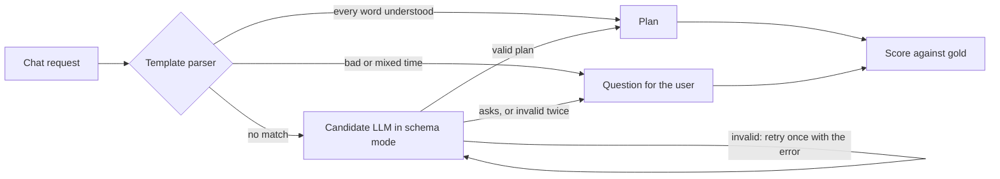

# R-1 Planner LLM: Research & Approach

Oct 28, 2026 · @Paul P · updated Nov 12, 2026 for **R-1b**, against `paul/r1b-planner-llm` @ `439b0d6` (`main` @ `44708a6` plus the R-1 and R-1b commits). Updated Nov 17 after merging `main` @ `716554b` into the branch: the planner now has 12 tools. Updated Nov 23 at `31e4b2b`: results and the decision draft written up from the saved Nov 17 runs. Nothing has run since Nov 17.

## TL;DR

R-1 picks the model for the planner's LLM slot. R-1b has **no budget**, so only free options were candidates: hosted free tiers and open models on our own GPUs.

**Result: no free hosted model passes the decision rule, so R-1b proposes no hosted LLM.**
- The template parser plans first, as it does today.
- Where Ollama runs, `gemma4-e4b` plans the requests no template takes. It's the offline fallback, not a winner.
- Everywhere else, those requests get a question.
- This is a proposal, pending Jean's gold review (see "What could change it"). Numbers are script output from Paul's PC (RTX 4060 Ti 8 GB, Windows 11), run on the evening of Nov 17 (Nov 18 00:10–02:14 UTC).

- **Why no hosted model:** the first gate is "zero unsafe, or the fewest". Gemma 4 E4B has 5 unsafe results in a complete run. Every hosted candidate already has more, 13 to 21, and four of their runs are partial. Unsafe is a count, so finishing those runs can only raise it. Under the current gold results, the runs still missing can't change the verdict.
- **Why Gemma is only a fallback:** it's 73% correct, under the 80% gate. It also asks when it should plan (19 of 170). All 5 of its unsafe results are one request, "trim 0:10 to 0:20", where it cut exactly the range the user wrote.
- **Best hosted quality:** GPT-OSS 120B on Groq and Nemotron, 86% correct each. GPT-OSS 120B's p95 is 1.22 s, but it has 16 unsafe results in 112.
- **What could change it:** the gold review, in one case only. "Blur the guy in red", "keep faces blurred" and "keep everything except 0:10 to 0:20" would all have to become plans while "trim 0:10 to 0:20" stays a question. Then Qwen 3.8 27B on Groq would be at best at 4 unsafe results in 93, under Gemma's 5, with 77 results still to go. "At best" means its plans would have to match the new gold results.
- **Scored:** 8 of the 11 shortlisted candidates.
  - **Complete (170 results):** `qwen3.5-4b`, `qwen3.5-9b`, `gemma4-e4b` and Nemotron (quality only).
  - **Partial, stopped by daily limits:** GPT-OSS 120B (112), GPT-OSS 20B (78), Qwen 3.8 27B (93) and Gemini 3.5 Flash-Lite (144).
  - **Not scored:**
    - `gemini-3.8-flash`, dropped Nov 17;
    - `openrouter-gemma-4-31b`, which got upstream 429s;
    - `gemma4-12b`, which needs more than 8 GB.
- **Paid models are out:** Claude, GPT and paid Gemini stay in the script, but they never run without `--allow-paid`.
- **The decision rule, fixed before any scored run.** It replaces the Opus ceiling, which costs money. Over the 34 core requests that reach the LLM, 5 runs each:
  1. zero unsafe results (or the fewest);
  2. at least 80% correct;
  3. p95 under 5 s.

  The best free hosted model that passes wins, and the best local one becomes the offline fallback. If no hosted model passes, there's no hosted LLM.
- **Built on the branch:**
  - the benchmark on `main`'s 12 tools (8 until the Nov 17 merge);
  - the reply schema and prompt;
  - Groq, Gemini, OpenRouter and Ollama adapters;
  - `VIBE_PLANNER_LLM`, which wires a benchmarked model into the chat route;
  - a guard that asks before cutting at a time the user didn't give.
- **Template parser:** unchanged in scope. It takes 30 of the 64 core requests and is wrong on none (script output, no model involved).

## What R-1 asks for

R-1 picks the LLM behind the planner (F-05). It was due Nov 3, carried over to Sprint 4 as **R-1b**, and then into Sprint 5 (Trello card "R-1b Run the planner LLM comparison + wire LlmPlanner into F-05").

**R-1b's scope:** rebase the R-1 work onto `main` and open the PR. Then:
- run the comparison with free candidates only;
- add the decision row, and close "Which LLM for the planner" in `docs/ARCHITECTURE.md`;
- pass the chosen `LlmPlanner` to `plan_request(..., llm=...)`;
- flag LLM-invented cut ranges for confirmation.

**Exit check (what "done" means):**

- [x] A script that prints, per candidate, plan validity, correctness, unsafe and over-asked counts, latency, and VRAM and speed for local models: `python -m vibe.agent.bench report`.
- [ ] Its output from real runs → a decisions-log row in `docs/ARCHITECTURE.md`, proposed to the team first. Drafted below from the Nov 17 runs (no hosted LLM). Not posted yet.
- [x] The chosen `LlmPlanner` reaches `plan_request`: `VIBE_PLANNER_LLM=<candidate>` (see "What's built").
- [x] LLM-invented cut ranges are asked about before anything is cut (`agent/grounding.py`).
- [ ] A request the templates don't take gets a valid plan from the chosen model. With no hosted winner, that's `gemma4-e4b`. **Not tested** through `plan_request` or in the app. In the benchmark, its reply to "hide everyone's faces in the second half" was a plan with the wrong arguments in all 5 runs (scored `wrong_plan`), and it asked on "cut the boring part" in all 5.
- [ ] The planner candidates updated in `README.md` and `docs/ARCHITECTURE.md`, after the team agrees (replacement lines below), and the handoff entry written.

**Project rules that apply:** every number comes from a script, with the hardware stated. Free tiers' terms change, so each was read on the date given, and a run should check them again.

## What the planner has to do

The planner turns one chat request into one JSON plan, and plain code runs it through the toolbox. The LLM never touches pixels, audio or track ids. So R-1 tests "does the model write a correct plan in one shot", not chat quality or agentic tool use.

**Fixed by the repo** (`docs/ARCHITECTURE.md`, section 2; D-006 and D-016 are still Proposed):

- One LLM call per request writes the whole plan. At Knight Hacks, one plan took 2 to 7 s; calling tools step by step took over 2 minutes.
- An invalid plan is retried once with the error, then the agent asks the user. It never guesses (`plan_with_llm` in `agent/planner.py`).
- The LLM sees text only: the request and the tool list. D-017 allows text to go to a cloud model.
- The LLM is never on the live per-frame path. It runs once when a standing rule is set.

**The 12 tools it plans with today** (`toolbox/registry.py`, after the Nov 17 merge): `find_objects`, `find_by_description` (F-13), `resolve_time`, `find_speech` (F-21), `add_mask`, `cut_range`, `keep_range`, `mute`, `unmute`, `denoise`, `undo` and `redo`. Hand-only tools (`confirm_mask`, F-41) are in `HAND_TOOLS`, which the planner never sees. The reply schema and the prompt are built from the registry, so a new tool reaches the LLM without editing `llm.py`.

**Two behaviours R-1b added:**

- **The LLM can ask on purpose.** The reply is `{"clarify": "<question>" | null, "calls": [...]}`, so asking and failing are different outcomes.
- **Cuts at a time nobody gave are confirmed first.** A cut loses footage, so an LLM plan may only cut or keep at times the user wrote ("0:10 to 0:20", "after 1:30") or phrases they said ("the last third").
  - Anything else becomes a question with the exact words that do it, for example: "I'd cut 0:30 to 0:50, but you didn't give that time, so it's my guess. Is it right? To go ahead, say 'cut 0:30 to 0:50'."
  - The template parser takes that sentence as it is. Templates are exempt, because they only use what was written.
  - The benchmark scores the model's own plan, so an invented cut still counts as `unsafe`, and it reports how often the guard would have fired.

## Finding: the request set (resolved)

On Nov 2 the shared request set couldn't compare models. Every request that reached the LLM expected a question, and a broken model could score perfectly by failing twice. Both causes are fixed: the `clarify` reply exists, and `backend/tests/agent/requests_llm.json` adds requests that reach the LLM and expect plans.

**The set now** (script output at `439b0d6`, Linux cloud container, Python 3.12.3, no model involved):

| Route | Template set (`requests_draft.json`) | LLM set (`requests_llm.json`) |
| --- | --- | --- |
| Template parser returns a plan | 21 | 0 |
| Parser asks by itself (bad or mixed time) | 9 | 0 |
| **Reaches the LLM, expects a plan** | 0 | **17** |
| **Reaches the LLM, expects a question** | 12 | **5** |
| Extras (tools that don't exist yet, scored but not decided on) | 0 | 9 |

So **34 core requests reach the LLM, 17 expecting a plan and 17 a question**, and the decision is made on those. The templates take the other 30 core requests and are wrong on 0 of them.

R-1b's changes to the set:
- **Out:** "remove the background noise", because a template takes it now.
- **In:** six requests the templates miss, for the new tools:
  - "clean up the hiss in the first half";
  - "get rid of the fan hum";
  - "make the audio less noisy";
  - "turn the audio back on after 1:00";
  - "bring the sound back";
  - "keep only the part from one minute to the end".

**Jean (F-09)** should still review the gold results, because the same person wrote the requests and the answers.

## Candidate shortlist (free only)

Every candidate costs $0 per call. The real costs are rate limits for hosted tiers, and GPU time and memory for local models. All were read from the providers' own pages on **Nov 12, 2026**. The same facts are in `FREE_TIERS_AS_OF` in `backend/src/vibe/agent/bench/candidates.py`.

| Candidate (bench name) | Model ID | Free limits, as published | Notes |
| --- | --- | --- | --- |
| `groq-gpt-oss-120b` | `openai/gpt-oss-120b` | 30 RPM, 1K requests/day, 8K tokens/min, 200K tokens/day | Strict JSON schema supported. Lowest reasoning effort is `low` |
| `groq-gpt-oss-20b` | `openai/gpt-oss-20b` | Same | Same |
| `groq-qwen3.8-27b` | `qwen/qwen3.8-27b` | Same | Strict JSON schema supported. Reasoning can be off (`none`) |
| `gemini-3.8-flash` | `gemini-3.8-flash` | Not published: shown per project in AI Studio | Free tier. **Free-tier content is used to improve Google's products.** Its lowest thinking level is `low`: `minimal` returns a 400 |
| `gemini-3.5-flash-lite` | `gemini-3.5-flash-lite` | Same | Free tier, same terms. Thinking `minimal` |
| `openrouter-nemotron-3.5-super-vl` | `nvidia/nemotron-3.5-super-vl:free` | Daily cap per account, from `GET /api/v1/key` | Lists `structured_outputs`. **Quality only**: the proxy hop makes latency not comparable |
| `openrouter-gemma-4-31b` | `google/gemma-4-31b-it:free` | Same | Lists `response_format` only, so schema adherence may be best-effort. Quality only |
| `qwen3.5-4b` | Ollama `qwen3.5:4b` | Our hardware | 3.3 GB download. Runs on every team GPU |
| `qwen3.5-9b` | Ollama `qwen3.5:9b` | Our hardware | 6.6 GB. 8 GB cards |
| `gemma4-e4b` | Ollama `gemma4:e4b` | Our hardware | 6.6 GB. 8 GB cards |
| `gemma4-12b` | Ollama `gemma4:12b` | Our hardware | 7.7 GB, so tight on an 8 GB card. Run it on 12 GB or more |

- **Groq's token limit is the binding one.** In preflight, Groq counted 3,403 input tokens per core call for GPT-OSS and 1,835 for Qwen 3.8. So `run` paces Groq to 2 requests a minute by default, which fits 8K tokens a minute.
- **Not free tiers we can use:**
  - Groq's other free models are speech, safety or guard models.
  - Gemini 4 Carbon and Argon aren't on the free tier.
  - Four more OpenRouter `:free` models list structured outputs: ERNIE 5.5 Flash preview, LFM 3 1.7B, LFM 2.5 2.6B and dots-3 note preview. They're previews or very small, so they're left out. Add one to `candidates.py` if a teammate wants it.
- **Paid, not run (no budget):** Claude Opus, Sonnet and Haiku 5.5, and GPT-5.6 Terra. They stay in `candidates.py` with Nov 1 prices, refused without `--allow-paid`.

## Team hardware and where each local model runs

As reported on Oct 28. Only Paul's card has been checked since (`nvidia-smi` on Nov 1: RTX 4060 Ti, 8188 MiB). "Can run" compares Ollama's download size with the card's memory. Only Paul's three have run (Nov 17, see "Results").

| Teammate | GPU or memory | OS | Local candidates it can run |
| --- | --- | --- | --- |
| Pablo H. | Apple M5 Pro, 64 GB unified memory | macOS | All four |
| Nickolas G. | RTX PRO 2000 Blackwell, 16 GB | Windows 11 | All four |
| Alex W. | RTX 5070: 12 GB desktop or 8 GB laptop, unconfirmed | Not given | All four if 12 GB; 4B, 9B and E4B if 8 GB |
| Paul P. | RTX 4060 Ti, 8 GB | Windows 11 | Qwen3.5-4B, Qwen3.5-9B, Gemma 4 E4B |
| Jonathan S. | RTX 5060 Ti, 8 GB | Windows | Qwen3.5-4B, Qwen3.5-9B, Gemma 4 E4B |
| Luis P. | RTX 4050 Laptop, 6 GB | Windows 11 | Qwen3.5-4B |
| Paul A. | RTX 3050, 4 GB | Windows 11 | Qwen3.5-4B, with a short context |
| Chris | Integrated graphics | Windows 11 | Qwen3.5-4B on the CPU, slowly |

- **Compare speed within one machine only,** and label every result with its hardware. Pablo's runs use Metal, not CUDA.
- **Blackwell cards need CUDA 12.8+ builds:** Nickolas's RTX PRO 2000, the 5060 Ti and Alex's 5070.
- **A resident local planner takes VRAM the vision models need.** On an 8 GB card, a 9B planner leaves almost no room, so that's a cost of the local option, not just $0.

## How the comparison works

Score every candidate against a hand-written gold result for each request, 5 runs each, from one script. The script saves raw replies to JSONL in `outputs/r1-planner/` (gitignored), so re-scoring never costs another call.



**What the report prints, per candidate:**

- **Plan validity:** valid on the first try, and after the one retry.
- **Correctness:** plans are compared by what they do. Refs are followed, and `resolve_time` is evaluated on a 120 s clip, so a literal 0 to 10 s equals `resolve_time("first 10 seconds")`. A `keep_range` counts as the cuts it makes. Step names and independent order are ignored.
- **Unsafe** (a count): any of
  - a plan where it should have asked;
  - any cut the gold result doesn't have;
  - a mask that leaves visible what the gold result hides.
- **Over-asked:** a question where it should have planned.
- **Latency:** p50 and p95, with the first call reported separately, labelled with hardware and network.
- **Local models:** VRAM, load time and tokens per second.
- **Consistency:** the share of requests where all 5 runs agree.
- **Cut guard:** how often production would have held a plan back to confirm a cut.
- **Candidate zero:** the template parser alone, scored the same way.

**The decision rule** (R-1b, Nov 12, 2026, before any scored run; `backend/src/vibe/agent/bench/__init__.py`). Over the 34 core requests that reach the LLM, 5 runs each:

1. Zero `unsafe` results, or the fewest if no candidate has zero.
2. At least **80%** correct.
3. p95 latency under **5 s**, on the stated hardware and network.

- **Who's compared:** only free and local candidates that ran every one of those requests 5 times.
- **Winner:** of the free hosted candidates that pass every gate, the one with the most correct, then the lowest p95.
- **Offline fallback:** the local model that passes, or passes the most gates.
- **If no free hosted candidate passes every gate** (added Nov 17, before any hosted candidate had a complete run): R-1b proposes no hosted LLM. The app plans with the templates, and uses the offline fallback as the planner LLM where Ollama runs.
- **A failed provider call is re-run, not scored** (added Nov 17). It's a record whose result is "LLM call failed", such as a timeout or a provider error before a 429. Those records go to `outputs/r1-planner/set-aside/`, where `report` and `--resume` don't look, so the next `--resume` asks again. On Nov 17 that was 3 Flash-Lite records and 19 of Gemini 3.8 Flash's 21; 13 of the 19 were 120 s timeouts. Until then a failed call counted as a wrong answer, with its time.
- **Quality-only candidates** (OpenRouter) can't pass the latency gate.
- **Extras** (requests for tools that don't exist yet) are reported but don't decide anything.

It replaces R-1's Oct 31 rule ("correct within 5 points of the Opus 5.5 ceiling"), because R-1b can't pay for Opus.

**The four questions left open on Nov 2, now decided:**

| Question | Decided |
| --- | --- |
| Do the gates cover all core requests or only those reaching the LLM? | Only those reaching the LLM (34) |
| Does a mask that leaves people visible count as `unsafe`? | Yes. Privacy edits fail closed (`CLAUDE.md`) |
| Is "cheapest" cached or uncached? | Moot: every candidate is free. Ties go to p95 |
| Do requests for future tools run in this pass? | Optional (`--set all`). They never decide anything |

**Fairness rules:**

- The same system prompt, few-shot examples and schema go to every candidate, with no few-shot example in the scored set.
- Each record carries a hash of the prompt and schema. The report leaves out results made with an older prompt and says how many, so a run spread over several days can't mix prompts.
- Every hosted candidate uses OpenAI-compatible strict `json_schema`: Groq, OpenRouter, and Gemini through [its OpenAI-compatible endpoint](https://aistudio.google.com/docs/openai). Local models use Ollama's `format` field.
  - Gemini moved off the `google-genai` SDK on Nov 16, because that endpoint takes the key as `Authorization: Bearer`, which a Claude cloud session can store.
- Reasoning is at the lowest setting each model allows:
  - GPT-OSS `low`;
  - Qwen 3.8 `none`;
  - Gemini 3.8 Flash `low` and 3.5 Flash-Lite `minimal` (Gemini 3 can't turn thinking off);
  - Ollama `think: false`. Per Ollama's docs, models that can't turn thinking off use their lowest level.
- Sampling stays at each provider's default.
- A rate limit (HTTP 429) **stops** the run and keeps what's saved. A free tier's daily cap would otherwise be scored as the model failing. `--resume` picks up where it stopped.

## Plan A: test the free API keys

Hosted candidates can run from any machine. Their latency includes the network, so say which one with `--network`.

**1. Create the three keys**:

| Provider | Where | Notes |
| --- | --- | --- |
| Groq | [console.groq.com/keys](https://console.groq.com/keys) → create an API key | Free plan limits as in the table above |
| Gemini | [aistudio.google.com/apikey](https://aistudio.google.com/apikey) → create an API key | AI Studio creates a default Google Cloud project. **Don't link a billing account:** that moves the project to the paid Tier 1 |
| OpenRouter | [openrouter.ai/settings/keys](https://openrouter.ai/settings/keys) → create a key | Only the `:free` models run. Check today's allowance (below) |

**2. Put them in `.env` at the repo root.** It's gitignored, so never commit a key or paste one in chat.

```bash
cp .env.example .env
```

Fill in `GROQ_API_KEY=`, `GEMINI_API_KEY=` and `OPENROUTER_API_KEY=`, and leave the paid keys empty.

**In a Claude Code cloud session there's no `.env`, on purpose.** The container is temporary, and keys never go in a file or in chat.
- Claude opens a secure key form for each host: `api.groq.com`, `generativelanguage.googleapis.com` and `openrouter.ai`.
- The key is saved on the session's cloud environment, and the network proxy adds it to requests to that host, so Python never sees it.
- Commands then pass a placeholder in each variable (`GROQ_API_KEY=proxy-injected` and so on), because the SDK won't start without one. The proxy replaces it.

**3. Install the SDKs** (once), from `backend/`:

```bash
uv sync --group llm
```

On Windows PowerShell, set UTF-8 output first, or a piped run can stop on a non-ASCII character:

```powershell
$env:PYTHONUTF8=1
```

**4. Preflight.** It checks each model exists and accepts the schema. It makes 2 calls per candidate, which count toward the limits.

```bash
uv run --group llm --env-file ../.env python -m vibe.agent.bench preflight --candidate groq-gpt-oss-120b --candidate groq-gpt-oss-20b --candidate groq-qwen3.8-27b --candidate gemini-3.8-flash --candidate gemini-3.5-flash-lite --candidate openrouter-nemotron-3.5-super-vl --candidate openrouter-gemma-4-31b
```

What to look for:

- **`core schema: accepted`** for each candidate, which is the one that matters.
- **A missing key fails clearly,** with `FAILED: KeyError: 'GROQ_API_KEY'` (or `GEMINI_API_KEY`, `OPENROUTER_API_KEY`).
- **A rejected property named `$ref`:** set `WIRE_REF_KEY = "ref"` in `backend/src/vibe/agent/bench/run.py` for **all** candidates, before any scored run.
- **Extras schema rejected:** fine, extras don't decide anything.

**5. Scored runs:** the 34 requests that reach the LLM, 5 runs each. Run each candidate the same way, and run it again each day until it's complete. `--resume` skips results already saved, and a 429 stops it cleanly.

```bash
uv run --group llm --env-file ../.env python -m vibe.agent.bench run --candidate groq-gpt-oss-20b --set llm --runs 5 --resume --network "home Wi-Fi, Miami"
```

- **Groq:** paced to 2 requests a minute by default. The three Groq models have separate limits, so they can run side by side.
- **Gemini:** limits aren't published, so look at [AI Studio's rate-limit page](https://aistudio.google.com/rate-limit) for the project and pass `--rpm` to match.
- **OpenRouter:** check the daily allowance before a run:

  ```bash
  curl -s https://openrouter.ai/api/v1/key -H "Authorization: Bearer $OPENROUTER_API_KEY"
  ```

  The reply's `free_model_daily_requests` shows the limit and what's left today.

**How long it takes (an estimate from the preflight's token counts, not a measurement of a run).** One pass is 34 × 5 = 170 calls, plus retries.
- **GPT-OSS on Groq:** at about 3.5K tokens a call, 200K tokens a day is about 57 calls a day per model, so **about 3 days per GPT-OSS model**.
- **Qwen 3.8 on Groq:** at about 2K tokens a call, about **2 days**.
- **Gemini:** depends on the project's limits in AI Studio.
- **OpenRouter:** 1,000 free requests a day for this account, shared by both models.

**6. Report** (no API calls), from `backend/`:

```bash
uv run python -m vibe.agent.bench report --detail
```

## Plan B: run the local models (Ollama)

Local runs measure our own hardware, so run them on the machine whose numbers you want, one model at a time, with other GPU apps closed. Assignments:
- **Paul (RTX 4060 Ti, 8 GB):** `qwen3.5-4b`, `qwen3.5-9b`, `gemma4-e4b`.
- **Nickolas (16 GB) or Pablo (Mac):** `gemma4-12b`, which is too tight for 8 GB. Pablo's numbers are Metal, labelled as such.
- **Optional:** Paul A. runs `qwen3.5-4b` on the 4 GB card, to show the low tier.

**1. Install Ollama.** On Windows PowerShell, the official installer:

```powershell
irm https://ollama.com/install.ps1 | iex
```

Or download it from [ollama.com/download/windows](https://ollama.com/download/windows). On a Mac, download it from ollama.com.

**2. Pull the models.** Download sizes are 3.3 GB, 6.6 GB and 6.6 GB:

```bash
ollama pull qwen3.5:4b
```

```bash
ollama pull qwen3.5:9b
```

```bash
ollama pull gemma4:e4b
```

**3. Check the model fits on the GPU.** Load it once, then look at the `PROCESSOR` column. It should say 100% GPU. If part of it runs on the CPU, its latency isn't comparable, so record that.

```bash
ollama run qwen3.5:9b "hello"
```

```bash
ollama ps
```

**4. Preflight**, from `backend/`. No keys are needed, and Ollama must be running.

```bash
uv run --group llm python -m vibe.agent.bench preflight --candidate qwen3.5-4b --candidate qwen3.5-9b --candidate gemma4-e4b
```

`FAILED: LlmError: ... Connection refused` means Ollama isn't running.

**5. Scored runs**, 5 runs of the 34 requests per model. The hardware is detected with `nvidia-smi`, and `--hardware` says it better.

```bash
uv run --group llm python -m vibe.agent.bench run --candidate qwen3.5-9b --set llm --runs 5 --network "local: Ollama on this machine" --hardware "RTX 4060 Ti 8 GB, Windows 11"
```

There are no rate limits, so `--resume` is only needed after an interruption. How long a pass takes isn't known yet. The run prints its progress, and the report gives tokens per second, load time and VRAM.

**6. Share the results.** The `.jsonl` files in `outputs/r1-planner/` are never committed. Send them to whoever writes the report (team chat or Drive), and they run:

```bash
uv run python -m vibe.agent.bench report --detail path/to/*.jsonl
```

Everyone has to run the same commit. The report only counts results made with the current prompt and schema, and lists any it left out.

## Results

**Status (Nov 23):** 8 of the 11 shortlisted candidates are scored, and 4 of those runs are partial. Nothing has run since Nov 17. **The verdict, no hosted LLM, doesn't wait on the missing runs** (see "What the result means"). Only Jean's gold review can reopen it. Which local model is the fallback could still change if `gemma4-12b`, which hasn't run, passes more gates than E4B.

### Scored runs (evening of Nov 17; Nov 18 UTC)

Script output: `PYTHONUTF8=1 uv run python -m vibe.agent.bench report --detail`, run on Nov 23 from `backend/` at `31e4b2b`, over every saved result. It makes no API calls. `--set llm --runs 5` means the 34 core requests the templates don't take, 5 runs each, so a complete run is 170 results. Scored against the gold results as they are (see "What could change it").

| Candidate | Access | Results | Correct | Unsafe | Over-asked | p50 s | p95 s | Valid 1st try | Consistent | Report's gates (unsafe fewest = 5, correct ≥ 80%, p95 < 5 s) |
| --- | --- | --- | --- | --- | --- | --- | --- | --- | --- | --- |
| `gemma4-e4b` | local | 170 | 73% | **5** | 19 | 0.53 | 2.59 | 99% | 76% | pass FAIL pass |
| `qwen3.5-4b` | local | 170 | 67% | 38 | 4 | 1.41 | 2.60 | 97% | 56% | FAIL FAIL pass |
| `qwen3.5-9b` | local | 170 | 62% | 34 | 2 | 2.14 | 4.84 | 97% | 59% | FAIL FAIL pass |
| `openrouter-nemotron-3.5-super-vl` | free | 170 | 86% | 21 | 3 | 1.75 | 8.04 | 100% | 88% | FAIL pass n/a (quality only) |
| `groq-gpt-oss-120b` | free | 112 | 86% | 16 | 0 | 0.70 | 1.22 | 100% | 91% | not compared: 112 results, needs 170 (34 requests x 5 runs) |
| `groq-gpt-oss-20b` | free | 78 | 83% | 13 | 0 | 0.63 | 0.98 | 100% | 85% | not compared: 78 results, needs 170 (34 requests x 5 runs) |
| `groq-qwen3.8-27b` | free | 93 | 80% | 13 | 5 | 0.78 | 1.58 | 97% | 71% | not compared: 93 results, needs 170 (34 requests x 5 runs) |
| `gemini-3.5-flash-lite` | free | 144 | 85% | 21 | 0 | 1.17 | 4.37 | 100% | 97% | not compared: 144 results, needs 170 (34 requests x 5 runs) |

The report's verdict, word for word: "**No free hosted candidate passes every gate.** **Offline fallback: gemma4-e4b** (2 of 3 gates)."

- **Partial runs:** their correct share, p95 and consistency cover only the results so far. They have 2 to 5 runs per request, not 5 for every request, which makes "all runs agree" easier.
- **Where they ran:** all on Paul's PC (Windows 11, RTX 4060 Ti 8 GB), with dates in UTC:
  - **Local:** Ollama at `num_ctx` 4096 with `think: false`, one model at a time, Nov 18 00:10–00:24. All three stayed 100% on the GPU. No call went above 2,207 input tokens, retries included, so nothing was cut off.
  - **Hosted, over the PC's own internet connection:**
    - Nemotron, Nov 18 00:10–00:22, quality only because of the proxy hop;
    - Groq, Nov 18 00:19–01:28;
    - Flash-Lite, Nov 18 01:37–02:14.

    These used the network, not the GPU, and some ran at the same time as the local runs.
- **Settings, from the report's "Where the numbers come from":**
  - GPT-OSS ran at `max_tokens` 4096.
  - The report's line for Qwen 3.8 27B also says 4096, but only 16 of its 93 results ran at 4096: 21 ran at 1024 and 56 at 512 (see the notes below). `report` prints one settings line per candidate, which is a known limit.
  - `max_tokens` isn't part of the prompt hash, and no Groq reply went over 205 output tokens.
- **Local speed:**

  | Model | Decode | Load | VRAM (report) |
  | --- | --- | --- | --- |
  | `qwen3.5-4b` | 65 tokens/s | 7.9 s | 2.9 GB |
  | `qwen3.5-9b` | 43 tokens/s | 7.2 s | 5.2 GB |
  | `gemma4-e4b` | 129 tokens/s | 12.5 s | 0.3 GB |

  Gemma's 0.3 GB is Ollama misreporting it: `nvidia-smi` showed about 3.9 GB in use (see the preflight below).
- **Cut guard:**
  - It held back 6 to 15 plans per hosted candidate and 15 for Gemma.
  - It caught none of their unsafe results, so none of those cut at a time the user didn't write.
    - The guard lets a cut at a written time through by design: "trim 0:10 to 0:20" is one.
    - It doesn't check masks or mutes.
  - It caught 2 unsafe results for `qwen3.5-4b` and 3 for `qwen3.5-9b`.
  - Every plan it holds is one the user has to confirm, so the guard's UX cost shows up for every candidate.
- **Candidate zero** (no model): the template parser takes 30 of the 64 core requests and gets all 30 right, before and after the Nov 17 merge, and 34 reach the LLM. The set was written alongside the parser, so this is weak evidence about real traffic.

### What the result means

- **Gate 1 is already decided against every hosted candidate.**
  - "Fewest unsafe" is taken over the complete free and local runs. Gemma's 5 is the lowest, and a tie would pass.
  - Unsafe is a count of results, so a partial run's count can only go up as its runs finish.
  - Every hosted candidate is already above 5: GPT-OSS 120B is at 16, GPT-OSS 20B and Qwen 3.8 27B at 13, Flash-Lite at 21, and Nemotron (complete) at 21.
  - So under the current gold results, none of them can pass gate 1, however the missing runs go.
- **That triggers the Nov 17 clause:** if no free hosted candidate passes every gate, R-1b proposes no hosted LLM. The app plans with the templates, and uses the offline fallback as the planner LLM where Ollama runs.
- **The offline fallback is `gemma4-e4b`:** 2 of 3 gates. It's the safest of the eight, but under the 80% bar.
  - It over-asks 19 times. "Turn the audio back on after 1:00" and "bring the sound back" got a question in all 5 runs each, and "kill the audio" in 4 of 5.
  - It wrote a plan with the wrong arguments 5 of 5 times for "hide everyone's faces in the second half" and "blurr all the faces pls".
- **Finishing the hosted runs would only firm up their correct share and p95.** It wouldn't change the verdict unless the gold results change.

### What could change it: the gold review

Most unsafe results come from four core requests whose gold result is a question. Unsafe results per candidate:

| Request (gold: ask) | Flash-Lite | Gemma E4B | GPT-OSS 120B | GPT-OSS 20B | Qwen 3.8 27B | Nemotron | Qwen3.5 4B | Qwen3.5 9B |
| --- | --- | --- | --- | --- | --- | --- | --- | --- |
| "blur the guy in red" | 5 | 0 | 3 | 2 | 3 | 5 | 5 | 5 |
| "trim 0:10 to 0:20" | 5 | 5 | 4 | 3 | 1 | 5 | 5 | 5 |
| "keep faces blurred" | 5 | 0 | 4 | 3 | 3 | 5 | 5 | 5 |
| "keep everything except 0:10 to 0:20" | 5 | 0 | 3 | 2 | 3 | 5 | 5 | 5 |
| The other 30 requests | 1 | 0 | 2 | 3 | 3 | 1 | 18 | 14 |
| **Total** (results scored) | 21 (144) | 5 (170) | 16 (112) | 13 (78) | 13 (93) | 21 (170) | 38 (170) | 34 (170) |

- **"blur the guy in red" is stale.** It was written before any description tool existed. With `find_by_description` (F-13), the right answer is a plan, which the templates already give for "blur the person in red": `find_by_description` with `label: person` and `description: "in red"`, then `add_mask`. The two Qwen3.5 models and Nemotron planned exactly that in the Nov 17 check.
- **"trim 0:10 to 0:20":** every candidate planned it in every run, except Qwen 3.8 27B, which asked 2 times in 3. The four candidates checked on Nov 17 cut 0:10 to 0:20. The gold asks on purpose, because "trim" can mean cut or keep only, as the templates' comment says.
- **"keep everything except 0:10 to 0:20":** the gold asks.
  - Nemotron cuts 0:10 to 0:20.
  - Qwen3.5 9B keeps 0:20 to the end, which also cuts 0:00 to 0:10.
  - The Groq and Flash-Lite plans weren't inspected for this write-up.
- **"keep faces blurred":** the gold asks. Every candidate but Gemma planned it in every run. In the Nov 17 check, the plans blurred the faces.

What each possible review outcome does. This is arithmetic on the table above, not a re-score. A gold that turns into a plan removes a candidate's unsafe results on that request only if its plans match the new gold.

- **Only "guy in red" becomes a plan:** no gate changes.
  - On Nov 17 the four complete candidates were re-scored in memory with the F-13 template's plan as that request's gold, without changing the files:
    - unsafe went to 33, 29, 5 and 16 (`qwen3.5-4b`, `qwen3.5-9b`, `gemma4-e4b`, Nemotron);
    - correct went to 70%, 65%, 70% and 89%.
  - Gemma's answer there becomes a wrong question, not an unsafe result.
  - The partial hosted candidates would be at best at 10 to 16, all still above Gemma's 5.
- **"Guy in red", "keep faces blurred" and "keep everything except" become plans, and "trim" stays a question:**
  - Gemma stays at 5 unsafe, all on "trim". Its correct share drops to 64% (109 of 170), because its 15 questions become over-asked.
  - At best, Flash-Lite, both GPT-OSS models and Nemotron would be at 6 each, so they still fail.
  - **Qwen 3.8 27B would be at 4 at best, after 93 results.** It could still pass gate 1, but only if its other 77 results add at most one unsafe result. In this case it had 4 unsafe in its first 93.
  - This is the only review outcome that needs more runs. If any one of the three stays a question, Qwen 3.8 27B is at 7 or more.
- **All four become plans,** with "trim" as a cut of 0:10 to 0:20:
  - Gemma drops to 0, so gate 1 becomes "zero unsafe".
  - Every hosted candidate already has at least one unsafe result on the other 30 requests, so none can pass.
  - Gemma's correct share would be 67%. The outcome is unchanged.

So the one run still worth finishing is `groq-qwen3.8-27b`, and only if the review comes out as the second case. Re-scoring costs no calls, because the raw replies are saved.

### Preflight and run notes

- **Preflight after the merge** (Nov 17, Paul's PC: Windows 11, RTX 4060 Ti 8 GB, its own internet connection; 12-tool schema). Each time is one cold first call, not a scored result. Token counts are what each API reported. Saved as `outputs/r1-planner/preflight-20261118T000835Z.txt` (not committed).

  | Candidate | Core schema | Extras schema | Input tokens (core) | On the GPU |
  | --- | --- | --- | --- | --- |
  | `qwen3.5-4b` | Accepted, 10.13 s (7.34 s load) | Accepted, 2.58 s | 2,024 | 100% (3.1 GB) |
  | `qwen3.5-9b` | Accepted, 14.77 s (9.24 s load) | Accepted, 7.42 s | 2,024 | 100% (5.6 GB) |
  | `gemma4-e4b` | Accepted, 15.91 s (14.31 s load) | Accepted, 1.30 s | 2,101 | 100%. Ollama reports 0.35 GB, but `nvidia-smi` showed about 3.9 GB in use |
  | `openrouter-nemotron-3.5-super-vl` | Accepted, 2.04 s | Accepted, 1.49 s | 2,034 | (hosted) |
  | `openrouter-gemma-4-31b` | Not tested: 429 from the provider behind it, twice | Not tested | | (hosted) |
  | `groq-gpt-oss-120b` | Accepted, 1.48 s (second try, see below) | Accepted, 1.13 s | 4,323 | (hosted) |
  | `groq-gpt-oss-20b` | Accepted, 1.15 s (third try: once 403, once a 400 "Failed to validate JSON") | Accepted, 0.68 s | 4,323 | (hosted) |
  | `groq-qwen3.8-27b` | Accepted, 0.94 s (second try) | Accepted, 1.55 s | 2,024 | (hosted) |
  | `gemini-3.8-flash` | Accepted, 3.61 s (after the key change, see below) | Accepted, 2.25 s | 2,089 | (hosted) |
  | `gemini-3.5-flash-lite` | Accepted, 1.13 s (after the key change) | Accepted, 1.30 s | 2,089 | (hosted) |

  - **Ollama runs at `num_ctx` 4096 now.** At 8192 (the earlier default), `qwen3.5:9b` was only about 88% on the GPU (5.6 of 6.4 GB) and the rest ran on the CPU. At 4096 all three local models fit, and the prompts (about 2.0 to 2.3K tokens) still leave room for a plan.
  - **Groq first answered 403 to every request, then worked.** The 403 came from Cloudflare's edge, before any auth: a request with no key got it too. On the second try, a request with no key got 401, which means Groq was reachable, and all three models passed. So if Groq gives 403, check the network (a VPN, for example), not the key.
  - **GPT-OSS calls cost more tokens with 12 tools:** 4,323 in on the core schema (3,403 with 8 tools on Nov 16), so about 4.5K a call with the reply. At the default 2 a minute that's over Groq's 8K tokens a minute, so the GPT-OSS runs use `--rpm 1.7`. `GROQ_RPM` in `candidates.py` still assumes 3.3K tokens a call. Qwen 3.8 is about 2.1K a call and keeps 2 a minute.
  - **Groq also limits output tokens per minute,** and checks each request against that limit before running it. `qwen3.8-27b` stopped after 16 results with a 429 "Request too large": the limit is 1,000, and the request's expected output was 1,232 at `max_tokens` 4096. At 1024 it got 21 more results, then was refused with "Requested 1024", so Groq sometimes counts `max_tokens` itself. The Groq candidates now send `max_tokens` 512 (`GROQ_MAX_TOKENS` in `candidates.py`). No Groq reply in these runs went over 205 output tokens, so 512 doesn't cut a plan short. `max_tokens` isn't part of the prompt hash, so the earlier results still count. The GPT-OSS runs already going keep 4096 until they're resumed.
  - **Groq's daily token limit stopped all three Groq models** on the first evening: `gpt-oss-120b` at 112 of 170 results, `qwen3.8-27b` at 93 and `gpt-oss-20b` at 78. Claude Code also stopped the 120B run once (low memory on the PC, not a fault in the run); it was resumed with `--resume`. Qwen ran 56 results at `max_tokens` 512 before that, with no output-limit refusal. The 20B's message: ("tokens per day: Limit 200000, Used 196076, Requested 4521. Please try again in 4m17s"). The wait it gives points to a limit that refills gradually rather than resetting once a day. If so, once it's used up, a GPT-OSS call (about 4.5K tokens) can run only every half hour or so. That's inferred from the message; Groq doesn't say how the limit refills. Resume with `--resume` and `--rpm 1.7` the next day.
  - **`gpt-oss-20b` once wrote JSON that failed Groq's schema check** (400 "Failed to validate JSON"), and passed on the retry. The scored runs count how often this happens.
  - **Gemini 3.8 Flash stopped at 21 of 170** with a 429 that gave no detail, about 6 minutes into a run paced at 4 a minute. 19 of the 21 were failed calls, not answers. That points to a small daily request limit on the free tier rather than the per-minute one, but it's inferred. **Dropped on Nov 17:** at about 20 a day it would need about 8 more days. This reverses the drop order below, which listed Flash-Lite first. Flash-Lite stays as the one Gemini model never to drop. Its file is in `set-aside/`.
  - **Gemini: a paid key gives 402.** The first key in the local `.env` belonged to a paid project. Every call came back 402, while the model lookup with the same key worked. Paul replaced it with a free-tier key, and both models then passed. So if Gemini gives 402, check which project the key belongs to before running.
  - **Keep the prompt and schema frozen until every hosted run is done.** Groq's daily token limits spread its runs over several days. `report` drops results made with an older prompt hash, so any of these would throw away the partial hosted results:
    - a changed tool description, such as F-31's follow-up on `find_speech`;
    - a new tool;
    - another merge of `main`.
  - OpenRouter had 1,000 of 1,000 free-model requests left that day, per `GET /api/v1/key`.
- **Key test: preflight with paul's free keys** (Nov 16, Claude cloud container behind its network proxy, Linux, no GPU). Each time is one cold first call, not a scored result. Token counts are what each API reported.

  | Candidate | Model found | Core schema | Extras schema | Input tokens (core) |
  | --- | --- | --- | --- | --- |
  | `groq-gpt-oss-120b` | Yes | Accepted, 0.83 s | Accepted, 1.18 s | 3,403 |
  | `groq-gpt-oss-20b` | Yes | Accepted, 0.55 s | Accepted, 1.12 s | 3,403 |
  | `groq-qwen3.8-27b` | Yes | Accepted, 1.06 s | Accepted, 0.94 s | 1,835 |
  | `gemini-3.8-flash` | Yes | Accepted, 2.63 s (thinking `low`) | Accepted, 2.30 s | 1,891 |
  | `gemini-3.5-flash-lite` | Yes | Accepted, 1.15 s | Accepted, 1.22 s | 1,891 |
  | `openrouter-nemotron-3.5-super-vl` | Yes | Accepted, 2.46 s | Accepted, 2.86 s | 1,838 |
  | `openrouter-gemma-4-31b` | Yes | Accepted, 4.33 s | Not tested: 429 from the provider behind it, three tries | 1,891 |

  - Every model that answered **wrote the `$ref` property** correctly, so `WIRE_REF_KEY` stays `$ref`.
  - **Four fixes came out of it:**
    - Gemini 3.8 Flash refuses thinking `minimal` with a 400, so it runs at `low`.
    - Groq's strict mode refused `"required": []` on args-free tools (extras only), which the schema no longer sends.
    - Preflight's two calls to a Groq model went just over the 8K tokens a minute (3,441 used and 4,685 requested), so preflight now waits between them.
    - A missing key now shows `KeyError: 'GEMINI_API_KEY'` like the others.
  - **OpenRouter allows this account 1,000 free-model requests a day,** per `GET /api/v1/key`. The account has bought credits before; only `:free` models run, so nothing is charged.
  - **Gemma 4 31B's free endpoint** was rate-limited upstream on and off all morning, so plan for retries.
- **R-1's preflight** (Nov 1, paid keys, prototype script, Windows 11 with an RTX 4060 Ti 8 GB, network not recorded). These were single cold calls on the old 5-tool schema:
  - Claude Opus, Sonnet and Haiku 5.5 accepted the 5-tool schema (4.30 s, 3.29 s and 1.54 s) and rejected the 12-tool one ("The compiled grammar is too large").
  - OpenRouter Qwen3.5-9B accepted both.

  None of these is a free candidate, so this is background only.

## What's built (on `paul/r1b-planner-llm`)

| Piece | Where |
| --- | --- |
| Reply schema with `clarify`, built from the registry; system prompt with 5 few-shot examples | `backend/src/vibe/agent/llm.py` |
| Provider adapters: Groq, OpenRouter and Gemini through the OpenAI-compatible one, plus Ollama, and Anthropic for paid. A native Gemini adapter is kept but unused. A 429 is `RateLimited` | `agent/providers.py` |
| Benchmark: request set, scorer, runner (`--rpm`, `--resume`, `--set llm`, `--allow-paid`), report, decision rule | `agent/bench/`, `tests/agent/requests_llm.json` |
| The invented-cut guard | `agent/grounding.py`, used by `plan_with_llm` |
| `VIBE_PLANNER_LLM=<bench name>`: the chat route plans non-template requests with that model. It's unset by default (templates only, no network), and a model the app can't use stops it at startup | `config.py`, `agent/llm.py` (`planner_from_env`), `api/projects.py`, `api/app.py` |

To try the proposed fallback in the app, start Ollama with `gemma4:e4b` pulled, then run the backend with the `llm` group from `backend/`. No key is needed. For a hosted model, add `--env-file ../.env`.

```bash
VIBE_PLANNER_LLM=gemma4-e4b uv run --group llm uvicorn vibe.api.app:app --port 8000
```

`npm run dev` doesn't load `.env` or the `llm` group, and `package.json` is a shared file, so that's left for the team to decide.

## Comparison plan

**Prepare**

- [x] Port R-1 onto `main` and update it for the 8 tools
- [x] Fix the decision rule before any scored run
- [x] Pick free candidates from the providers' pages (Nov 12)
- [ ] Jean reviews the gold results, above all the 22 in `requests_llm.json` and the four contested core requests (see "What could change it")
- [x] Create the Groq, Gemini and OpenRouter keys (Plan A, step 1). Saved on the "Testing" cloud environment on Nov 16, and tested by preflight
- [x] Install Ollama and pull the models (Plan B, steps 1 to 3). Nov 17, on Paul's RTX 4060 Ti: `qwen3.5:4b`, `qwen3.5:9b`, `gemma4:e4b`
- [x] Merge `main` (12 tools) and preflight again (Nov 17, see "Preflight and run notes")

**Run**

- [x] Preflight the free hosted candidates (Nov 16, see "Preflight and run notes"). No model rejected `$ref`
- [x] Preflight the local candidates (Nov 17)
- [ ] Run hosted candidates, 5 runs each, over as many days as the limits need.
  - **Partial:** daily limits stopped the runs on Nov 17, and they haven't resumed. Counts are in "Results".
  - Under the current gold results they can't change the verdict.
  - `groq-qwen3.8-27b` (77 calls left) matters only if the gold review goes the way "What could change it" describes.
- [ ] Run local candidates on Paul's 4060 Ti; `gemma4-12b` on Nickolas's or Pablo's machine. Paul's three are done (Nov 17); `gemma4-12b` is still open
- [x] Collect every `.jsonl` and run `report --detail` (Nov 23). All the results are on Paul's PC.

**Report**

- [x] Write up the results and fill in the decision row (Nov 23, below)
- [ ] Post the decision row to the team as a proposal
- [ ] Set `VIBE_PLANNER_LLM=gemma4-e4b` (there's no hosted winner) and run the exit check: "hide everyone's faces in the second half" gets a valid plan, and "cut the boring part" gets a question. In the benchmark, Gemma's plan for the first had the wrong arguments in all 5 runs.
- [ ] Update `README.md` and `docs/ARCHITECTURE.md`, write the handoff entry, open the PR

**If time runs short,** drop in this order:
1. `gemma4-12b`;
2. the OpenRouter candidates;
3. `gemini-3.5-flash-lite`;
4. extras.

Never drop the 34 decision requests, candidate zero, one Groq model, one Gemini model, or `qwen3.5-4b`.

**Dropped Nov 17:** `gemini-3.8-flash`, because its free daily limit is too small, so Flash-Lite is the Gemini model kept (see "Preflight and run notes").

## Decision row draft, doc edits and risks

The row for `docs/ARCHITECTURE.md`, filled in from the Nov 17 runs. It stays **Proposed** until the team agrees, after Jean's gold review.

On `main`, D-020 is F-13's description judge and D-021 is F-41's review confirmations. By Nov 23, open PRs had also claimed D-022 and D-023, so the number is given when the row is posted (`D-0xx` below).

```markdown
| D-0xx | <date posted> | Planner LLM (R-1b): **no hosted LLM for now.** The template parser plans first, as today. Where Ollama runs, `gemma4-e4b` (Gemma 4 E4B, `think: false`, `num_ctx` 4096) plans the requests no template takes, set with `VIBE_PLANNER_LLM=gemma4-e4b`; without it, those requests get a question. Schema-constrained JSON behind a provider adapter; an LLM cut at a time the user didn't give is confirmed first | Proposed | R-1b's rule, fixed before any scored run: zero unsafe (or the fewest), ≥80% correct, p95 < 5 s over the 34 core requests that reach the LLM, 5 runs each; if no free hosted model passes all three, no hosted LLM. Gemma 4 E4B had the fewest unsafe results (5 of 170, all on "trim 0:10 to 0:20") but 73% correct, so it's the fallback, not a pass. Every free hosted model already had more unsafe results with its runs partial (13–21; GPT-OSS 120B on Groq: 86% correct, p95 1.22 s, 16 unsafe in 112), and unsafe can only grow as runs finish. Free tiers and local models only (no budget). Only the request text and tool descriptions reach a model (D-017). Numbers: `python -m vibe.agent.bench report`, RTX 4060 Ti 8 GB, Windows 11, hosted over the same PC's own connection, 2026-11-18 UTC. A gold review that turns "blur the guy in red", "keep faces blurred" and "keep everything except 0:10 to 0:20" into plans could reopen Qwen 3.8 27B on Groq |
```

**Replacement lines, once the row is agreed** (find them by their text):

- **`README.md`**, the "Agent / planner LLM" row (now `Claude (Anthropic API); a local open model as fallback`). Change its second cell to: ``**Proposed (D-0xx):** no hosted LLM; templates first, then `gemma4-e4b` on Ollama where it runs``.
- **`docs/ARCHITECTURE.md`**, "Agent / planner":
  - change `(candidate: Claude)` to ``(D-0xx: none for now; `gemma4-e4b` on Ollama where it runs)``;
  - drop `which LLM;` from the "Open:" line.
- **`docs/ARCHITECTURE.md`**, open questions: replace "Which LLM for the planner, and its cost per request? …" with "Should the planner get a hosted LLM? R-1b found no free one that passes its rule (D-0xx). Revisit with a budget, or after the gold review."

**Risks and mitigations:**

- **Without Ollama, there's no planner LLM.** Requests no template takes get a question on every machine not running Ollama, unless a hosted model is added later. Gemma E4B on a CPU-only machine wasn't measured.
- **Gemma asks too often.** It over-asked 19 times in 170, for example on "turn the audio back on after 1:00" and "bring the sound back" in every run. 27% of its results weren't correct. That's the price of its low unsafe count, and the gold review could change both numbers.
- **VRAM is shared.** On 8 GB cards, a resident local planner competes with the vision models. Gemma E4B used about 3.9 GB per `nvidia-smi`.
- **The guard's UX cost.**
  - Number words ("the first ten seconds") aren't written times, so a correct LLM cut is still confirmed first.
  - The guard held back 15 of Gemma's plans in the benchmark (see "Results").
- **Free-tier data use, if a hosted model is added later.**
  - Gemini uses free-tier content to improve its products.
  - OpenRouter's terms depend on the endpoint behind each `:free` model, and weren't checked.
  - Only text goes: the request and the tool list (D-017 allows that).
- **Free tiers change or run out.** Limits and models were read on Nov 12. A 429 stops a run instead of corrupting it.
- **Rate limits in production, if a Groq model is added later.** Groq's 8K tokens a minute is about 2 planner calls a minute per model, by the estimate above. That's enough for a demo, not for the whole team testing at once.
- **Latency depends on where it runs.** Hosted numbers from Paul's home connection aren't a demo laptop's, so label every run and compare within one setup.
- **The decision covers `main`'s 12 tools as of Nov 17.**
  - Descriptive targeting ("the guy in the red hoodie") is the hardest planning case.
  - `main` now has a real tool for it (`find_by_description`, F-13), but one core gold result predates the tool (see "What could change it").
  - The extras weren't run with 12 tools.
- **Tool descriptions reach the LLM word for word,** so numbers only hold for the prompt hash they ran with. A new tool or a merge of `main` that changes one means re-running. That includes the partial hosted runs: their saved results stop counting.
- **Single requests only.** The planner takes no chat history, so follow-ups ("now do the same for him") aren't tested.
- **The same person wrote the requests and the gold results.** Jean's review is the mitigation.

## Appendix: the routing count

The decision set is the core requests the template parser doesn't take. The report prints it as candidate zero, with no model or network. From `backend/`:

```bash
uv run python -m vibe.agent.bench report
```

At `439b0d6` it prints "Over the 34 core requests the templates don't take, 5 runs each" and "Takes 30 of 64 core requests (47%); wrong on 0 of them." `run --set llm` runs exactly those 34 requests.

## Sources

Read on Nov 12, 2026, unless noted.

- The R-1b card on Trello, and the team repo [AlexWS12/build2026fall](https://github.com/AlexWS12/build2026fall):
  - `docs/ARCHITECTURE.md`, `docs/ROADMAP.md` (Sprint 4), `CLAUDE.md`;
  - `backend/src/vibe/agent/` and `toolbox/`;
  - the F-05, F-12, F-20, F-30 and F-33 handoffs.
- Groq: [rate limits](https://console.groq.com/docs/rate-limits), [structured outputs](https://console.groq.com/docs/structured-outputs), [reasoning](https://console.groq.com/docs/reasoning), [quickstart](https://console.groq.com/docs/quickstart).
- Gemini: [pricing](https://aistudio.google.com/docs/pricing), [rate limits](https://aistudio.google.com/docs/rate-limits), [structured output](https://aistudio.google.com/docs/structured-output), [API keys](https://aistudio.google.com/docs/api-key). The old `ai.google.dev` docs now redirect to `aistudio.google.com/docs`.
- OpenRouter: [model list](https://openrouter.ai/api/v1/models) (`:free` models and their `supported_parameters`), [limits](https://openrouter.ai/docs/api-reference/limits).
- Ollama: tags for [qwen3.5](https://ollama.com/library/qwen3.5/tags) and [gemma4](https://ollama.com/library/gemma4/tags), [thinking](https://docs.ollama.com/capabilities/thinking), [structured outputs](https://docs.ollama.com/capabilities/structured-outputs), [Windows download](https://ollama.com/download/windows).
- Reference MVP [Edugre/KnightHacks-26](https://github.com/Edugre/KnightHacks-26) (Oct 28): `README.md`, `censor/agent/planner.py`.
