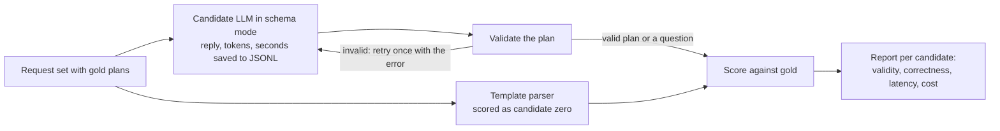

# R-1 Planner LLM: Research & Approach

Oct 28, 2026 · @Paul P · updated Nov 1, 2026 to match the codebase at `paul/r1-planner-llm` (`82d1bda`)

## TL;DR

Run R-1 as a scored bake-off: run each candidate 5 times on the shared request set through one script (`python -m vibe.agent.bench`), and pick the cheapest model that passes a decision rule fixed before any scored run. The script is built, but **no candidate has been scored and nothing is picked yet.**

- **Shortlist:** Claude Haiku 5.5, Claude Sonnet 5.5, GPT-6.1 Terra and Gemini 3.8 Flash (hosted); Qwen3.5-4B, Qwen3.5-9B and Gemma 4 12B (local, sized to the team's 4 to 16 GB GPUs); Claude Opus 5.5 as the ceiling.
- **Hypothesis to test, not assume:** a small, cheap model may be enough, because the plan is short and schema-constrained. Haiku 5.5 costs $0.10 / $0.50 per 1M tokens; let the numbers decide.
- **Blocking the scored runs:** OpenAI and Gemini are out of credits on Paul's keys, and Ollama isn't installed.
- **Template parser:** literal requests only (fixed nouns, explicit times, whole-audio actions), scored in the same run as "candidate zero". It takes 26 of the 50 core requests and is wrong on 0 (script output).


## What R-1 asks for

R-1 picks the LLM behind the planner (F-05), and it is due Nov 3, 2026; F-05's LLM half is blocked until it lands.

Scope: an open choice between a hosted model (Anthropic, OpenAI, Google, ...) and an open-weight model on our own hardware. Shortlist a few, compare them on a draft set of about 20 requests shared with F-09, and decide which requests the template parser takes instead of the LLM.

**Exit check (what "done" means):**

- [ ] A script that prints, per candidate: plan validity, latency and cost per request (for open models, the hardware it needs). The script is built; it has no real output yet.
- [ ] A decisions-log row in `docs/ARCHITECTURE.md`, proposed to the team before it is accepted. There's a draft below.
- [ ] A write-up in the handoff entry (`/b-handoff`). `docs/handoffs/2026-11-01-paul-r1-planner-llm.md` exists, with no results yet.
- [ ] The planner candidates updated in `README.md` and `docs/ARCHITECTURE.md`. They're still stale at `README.md:135`, `docs/ARCHITECTURE.md:40` and `:266`.

**House rules that apply:** every number comes from a script with the hardware stated; the work is on branch `paul/r1-planner-llm`, and that branch's R-1 row in `docs/ROADMAP.md` names Paul and the branch.

## What the planner has to do

The planner turns one chat request into one JSON plan, and plain code runs it through the toolbox; the LLM never touches pixels, audio or track ids. That shapes the whole evaluation: R-1 tests "does the model write a correct plan in one shot", not chat quality or agentic tool use.

**Fixed by the repo** (`docs/ARCHITECTURE.md`, section 2, and D-006, which is still Proposed):

- One LLM call per request writes the whole plan. At Knight Hacks, one plan took 2 to 7 s; calling tools step by step took over 2 minutes.
- An invalid plan is retried once with the error, then the agent asks the user to clarify. It never guesses (`plan_with_llm` in `agent/planner.py`).
- The LLM sees text only. Today that's the request and the tool descriptions (`agent/llm.py`). `docs/ARCHITECTURE.md` also lists video metadata and tool summaries, but neither is passed yet. PR #17 (R-4, open) proposes D-017: text and metadata may go to a cloud LLM, and the planner never sees pixels.
- The LLM is never on the live per-frame path. It runs once when a standing rule is set.

**What Knight Hacks did** (`censor/agent/planner.py` in the reference repo): the plan was an *intent*, not a list of raw tool calls. It held `action`, `effect` and `targets`, each target a detector noun plus yes/no questions for the VLM and a time phrase. Deterministic code expanded that into tool calls. The only LLM its README names is Qwen3-VL-8B, run locally on a resident model server.

**What changed in the codebase since the first draft:**

- **The toolbox exists.** F-05 merged `backend/src/vibe/agent/` (template parser, plan validation, clarify). F-06 adds `backend/src/vibe/toolbox/` with five tools: `find_objects`, `resolve_time`, `add_mask`, `cut_range` and `mute`. F-06 is in PR #16, still open, and this branch is stacked on it.
- **The plan format is tool calls, not intents.** F-05 merged `{step_id, tool, args}`, where an argument `{"$ref": "s1"}` uses an earlier step's result (D-016, Proposed). The template parser and the LLM share that format, so the intent-level schema from the first draft was dropped.
- **Only those five tools are real.** Descriptive targets, cut-by-transcript, speakers, denoise, standing rules and undo have no real tool yet. R-1 tests them through an eval-only draft registry, `agent/bench/extras.py`, which is reported but doesn't decide anything.
- **The candidate list in the repo is still stale:** `docs/ARCHITECTURE.md` names Claude Opus 5 and Sonnet 5, and `README.md` says "Claude; a local open model as fallback". Updating both is part of the exit check.


## Candidate shortlist

Seven candidates: four hosted (two Claude, one OpenAI, one Google) and three open-weight sizes matched to the team's GPUs (see the hardware section below), plus Opus 5.5 as a quality ceiling. Every hosted option supports schema-constrained JSON output, so "valid JSON" is nearly free and the real test is whether the plan is *correct*. Hosted prices were read from vendor pages on Nov 1, 2026.


| Candidate                                                                                                    | Runs on                                                                     | Price, input / output per 1M tokens                  | Cost per request (estimate)        | Why it's on the list                                                                                             |
| ------------------------------------------------------------------------------------------------------------ | --------------------------------------------------------------------------- | ---------------------------------------------------- | ---------------------------------- | ---------------------------------------------------------------------------------------------------------------- |
| [Claude Haiku 5.5](https://platform.claude.com/docs/en/models/haiku-5-5/overview) (`claude-haiku-5-5`)       | Anthropic API                                                               | $0.10 / $0.50 (prompts up to 100k tokens)            | ~$0.0006                           | Cheapest hosted option found; strict JSON-schema output                                                          |
| [Claude Sonnet 5.5](https://platform.claude.com/docs/en/models/sonnet-5-5/overview) (`claude-sonnet-5-5`)    | Anthropic API                                                               | $2 / $10                                             | ~$0.012                            | Replaces the repo's stale Sonnet 5 candidate at the same price                                                   |
| [GPT-6.1 Terra](https://developers.openai.com/api/docs/models/gpt-6.1-terra) (`gpt-6.1-terra`)               | OpenAI API                                                                  | $1 / $5                                              | ~$0.006, plus any reasoning tokens | OpenAI's "fast and efficient" tier, about half the price of GPT-5.6 Terra ($2 / $12); reasoning effort `none`    |
| [Gemini 3.8 Flash](https://ai.google.dev/gemini-api/docs/pricing) (`gemini-3.8-flash`)                       | Google API                                                                  | $0.75 / $3.75 until Dec 31, 2026, then $1.50 / $7.50 | ~$0.0045                           | Has a free tier, but free-tier content may be used to improve Google's products                                  |
| [Qwen3.5-4B](https://ollama.com/library/qwen3.5/tags) (`qwen3.5:4b`)                                         | Every team GPU, tight on the 4 GB RTX 3050; CPU on integrated graphics      | $0 (3.3-4.0 GB on Ollama)                            | Hardware only                      | The local fallback the whole team can run                                                                        |
| [Qwen3.5-9B](https://ollama.com/library/qwen3.5/tags) (`qwen3.5:9b`)                                         | 8 GB cards: the RTX 4060 Ti, the RTX 5060 Ti                                | $0 (6.6-7.6 GB on Ollama)                            | Hardware only                      | Qwen reports 66.1 on the BFCL-V4 tool-calling benchmark ([vdf.ai](https://vdf.ai/blog/best-local-llm-by-vram/)). |
| [Gemma 4 12B](https://ollama.com/library/gemma4/tags) (`gemma4:12b`)                                         | 12 GB and up: Nickolas's 16 GB card, Pablo's Mac, Alex's 5070 if it's 12 GB | $0 (7.7-8.0 GB on Ollama)                            | Hardware only                      | Best 12 GB pick in the vdf.ai guide; Apache 2.0                                                                  |
| [Claude Opus 5.5](https://platform.claude.com/docs/en/models/opus-5-5/overview) (`claude-opus-5-5`), ceiling | Anthropic API                                                               | $4 / $20                                             | ~$0.024                            | If the strongest model fails a request, suspect the gold plan first                                              |


The cost column is for budgeting, not a measurement: 4,000 input tokens and 400 output tokens, no caching. Replace it with script output. Caching the fixed system prompt cuts most of the input cost (Claude cache reads are 0.05x to 0.1x the input price), and the Claude and OpenAI adapters and the report already account for it.

**How this differs from** `bench/candidates.py`**:** the code still lists `gpt-5.6-terra` ($2 / $12, which would bring the budget below to about $13.50) and doesn't have Qwen3.5-4B. Both are worth changing before the first scored run. The rule picks the cheapest model that passes, so the older Terra could rule out OpenAI on price alone, and no call has reached it yet. Without Qwen3.5-4B, the "offline fallback" could be a model most of the team can't run. The code also has one extra candidate, Qwen3.5-9B through OpenRouter, for quality only: a proxy hop means it makes no latency or cost claims, and it's left out of the decision.

**Larger local models, optional, not re-checked since the first draft:** gpt-oss-20b fits Nickolas's card on its own, and Qwen3.6-27B or Qwen3.6-35B-A3B fit Pablo's Mac. None leaves room for vision models on a team GPU, so they only show how good local can get. **Cheaper hosted swaps:** [GPT-6 Luna](https://developers.openai.com/api/docs/models/gpt-6-luna) ($0.10 / $0.50, the same price as Haiku) for Terra; Gemini 3.5 Flash-Lite for 3.8 Flash, not re-checked.

**One extra idea, on hold:** Knight Hacks' resident Qwen3-VL also appears to have served as its planner, so planning cost no extra VRAM. R-3 (merged) shortlists no VLM, so there's no model to test that with yet. Qwen3.5-9B has a vision encoder according to the vdf.ai guide, so its planning score would be a first data point.

## Team hardware and where each local model runs

Five of the eight machines have 8 GB of GPU memory or less, so a local planner the whole team can run is a ~4B model. Unless Qwen3.5-4B scores close to the hosted models, expect a hosted primary planner (D-002 allows it), with local only as the fallback.

As reported for the first draft on Oct 28. Only Paul's card has been checked since (8188 MiB in the preflight). "Can run" compares Ollama's listed size with available memory; none of these has been run yet.


| Teammate    | GPU or memory                                                                           | OS         | Local candidates it can run                           | Also has                                       |
| ----------- | --------------------------------------------------------------------------------------- | ---------- | ----------------------------------------------------- | ---------------------------------------------- |
| Pablo H.    | Apple M5 Pro, 64 GB unified memory                                                      | macOS      | All three, plus the optional Qwen3.6 models           | Claude API credits (100)                       |
| Nickolas G. | [RTX PRO 2000 Blackwell](https://hmc-tech.com/gpu/nvidia-rtx-pro-2000-blackwell), 16 GB | Windows 11 | All three, plus the optional gpt-oss-20b              | MDC Makers Space                               |
| Alex W.     | RTX 5070: 12 GB desktop or 8 GB laptop, no survey reply yet                             | Not given  | All three if 12 GB; Qwen3.5-4B and 9B if 8 GB         |                                                |
| Paul P.     | RTX 4060 Ti, 8 GB                                                                       | Windows 11 | Qwen3.5-4B, Qwen3.5-9B                                |                                                |
| Jonathan S. | RTX 5060 Ti, 8 GB                                                                       | Windows    | Qwen3.5-4B, Qwen3.5-9B                                | FIU quantum computer, from 2027                |
| Luis P.     | [RTX 4050 Laptop](https://www.nvidia.com/en-us/geforce/laptops/40-series/), 6 GB        | Windows 11 | Qwen3.5-4B                                            | HiPerGator (UF)                                |
| Paul A.     | RTX 3050, 4 GB                                                                          | Windows 11 | Qwen3.5-4B at `q4_K_M` (3.3 GB), with a short context |                                                |
| Chris       | Integrated graphics                                                                     | Windows 11 | Qwen3.5-4B on the CPU, slowly                         | $400 Snowflake credits, $30 Gemini API credits |


- **Paul can run the 8 GB tier.** Qwen3.5-4B and 9B run on the 4060 Ti, then the same script goes to Nickolas (Gemma 4 12B, optional gpt-oss-20b) and Pablo (Mac runs). Gemma's 7.7-8.0 GB leaves no room for its context on an 8 GB card, so Ollama would likely run part of it on the CPU and its latency wouldn't be comparable.
- **Compare speed within one machine only.** The same model runs at different speeds on a 4060 Ti, a Blackwell card and an M5 Pro, so label every row with its hardware. Pablo's runs use Metal through Ollama or llama.cpp, not CUDA.
- **Blackwell cards need CUDA 12.8+ builds:** Nickolas's RTX PRO 2000, the 5060 Ti and Alex's 5070. The 4060 Ti, the 4050 and the 3050 don't.
- **Credits can cover the hosted runs:** Pablo's Claude credits for Haiku, Sonnet and the Opus ceiling, and Chris's Gemini credits for 3.8 Flash. Paul's own OpenAI and Gemini keys are out of credits. The 250 OpenAI calls cost about $1.50 at the estimate above.
- **This table is also useful for F-08's GPU survey.** F-08's exit check is a survey table under "Compute" in `docs/ARCHITECTURE.md`, so share it with Eduardo.


## How to run the comparison

Score every candidate's plan against a hand-written gold plan for each request, 5 runs each, from one script that saves raw replies to JSONL in `outputs/r1-planner/` (gitignored). Re-scoring then never costs another API call.

```bash
cd backend
PYTHONUTF8=1 uv run --group llm --env-file ../.env python -m vibe.agent.bench preflight
PYTHONUTF8=1 uv run --group llm --env-file ../.env python -m vibe.agent.bench run --candidate opus-5-5 --set core --runs 5 --max-usd 10 --network "<your connection>"
uv run python -m vibe.agent.bench report
```




The bench runs each LLM on every request, including the ones the template parser takes, then reports a routed result too (the parser where it claims a request, the LLM otherwise). Both routes produce the same plan type, so the template parser is scored exactly like the models.

**1. The plan schema already exists.** `reply_schema(registry)` in `agent/llm.py` generates one JSON schema from the tool registry: `{"clarify": string or null, "calls": [one variant per tool]}`. It has no recursion, no numeric or length limits, closed objects, and nullable optional fields. A renamed tool updates the schema, so F-06 changing a tool doesn't mean rewriting it. Limits the schema can't express are checked afterwards by `validate_plan`.

The first draft said a schema that compiles on Claude will work with every provider. The preflight fits that so far, but OpenAI strict mode, Gemini and Ollama are still untested. It also found a limit the draft didn't expect (see [Results so far](#results-so-far)).

**2. The request set is bigger than planned and is JSON, not YAML.** It's 60 requests with gold plans: F-05's 34 in `backend/tests/agent/requests_draft.json` plus R-1's 26 in `requests_llm.json`. 50 use the five real tools (core), and 10 use the eval-only tools (extras). Jean (F-09) should adopt or extend the same format.


| Category                 | Example request                                   | Count | Tools  | A correct result shows                         |
| ------------------------ | ------------------------------------------------- | ----- | ------ | ---------------------------------------------- |
| Template plan (F-05)     | "blur people for the first half"                  | 18    | Core   | The same plan the template parser makes        |
| Template question (F-05) | "cut it", "cut 10 to 20"                          | 16    | Core   | A question, no edits                           |
| Paraphrase               | "kill the audio"                                  | 4     | Core   | The plan, from words the parser doesn't know   |
| Number words             | "get rid of the first ten seconds"                | 2     | Core   | The time kept, in digits                       |
| Two actions              | "take out 0:10-0:20 and also 1:00-1:10"           | 2     | Core   | Two complete edits                             |
| Time phrasing            | "pixelate faces from 30 seconds in until the end" | 2     | Core   | The right range                                |
| Typo                     | "blurr all the faces pls"                         | 1     | Core   | The plan anyway                                |
| Should ask               | "cut the boring part", "blur her face"            | 5     | Core   | A question, no edits                           |
| Descriptive target       | "blur the guy in the red hoodie"                  | 4     | Extras | Object `person`; clothing in a yes/no question |
| Cut by content           | "cut the part where he talks about the weather"   | 1     | Extras | A speech search, not an invented timestamp     |
| Audio by speaker         | "mute the guy on the right"                       | 1     | Extras | A speaker search                               |
| Audio                    | "remove the background noise"                     | 1     | Extras | `denoise`                                      |
| Standing rule            | "from now on, only I am visible"                  | 1     | Extras | `add_rule`, person, except the enrolled user   |
| History                  | "undo that"                                       | 1     | Extras | `undo`                                         |
| Should ask               | "remove the people in the background"             | 1     | Extras | A question: no removal tool in v1              |


The first draft's follow-up category ("now do the same for him") isn't in the set, because `LlmPlanner.plan(request, tools, error)` takes no chat history. "Make it look cinematic" isn't scored either, because it's now a few-shot example in the prompt.

**3. Metrics printed per candidate** (`bench/report.py`):

- **Plan validity:** share of replies that parse and validate, on the first try and after the one retry.
- **Plan correctness:** plans are compared by what they do (`bench/score.py`): refs followed, `resolve_time` evaluated on a 120 s clip, step names and independent order ignored. Yes/no questions match by required keywords ("red", "hoodie"), not exact text.
- **Unsafe and over-asked counts:** a plan where it should have asked, or any cut the gold plan doesn't have, is unsafe. A question where it should have planned is over-asked.
- **Latency:** p50 and p95 wall time, with network and hardware stated. The first call is reported separately: Claude compiles a new schema on first use, and local models load into VRAM.
- **Cost per request:** token usage returned by each API times the price table. For local models, VRAM, load time and tokens per second instead.
- **Consistency:** share of core requests where all runs gave the same result.

**Decision rule,** fixed on Oct 31 and amended on Nov 1, both before any scored run (`agent/bench/__init__.py`). Over the core requests, all runs:

1. Zero `unsafe` results, or the fewest if no candidate has zero.
2. Correct within 5 points of the Opus 5.5 ceiling.
3. p95 latency under 5 s.

The cheapest hosted candidate that passes wins. The local model that passes, or comes closest, becomes the offline fallback. Extras are reported but don't decide anything. A candidate is only compared if it ran exactly what the ceiling ran.

**4. Keep it fair:**

- Same system prompt, few-shot examples and schema for every candidate (`system_prompt`, `reply_schema`). None of the 4 few-shot examples is in the scored set.
- Each provider's native schema mode: Claude `output_config.format`, OpenAI strict Structured Outputs, Gemini `response_json_schema`, Ollama's `format` field.
- Lowest reasoning setting per candidate (`bench/candidates.py`), since reasoning tokens add latency and cost. Opus can't turn thinking off, so it uses low effort.
- Temperature stays at each provider's default for everyone, because Claude 5.x rejects `temperature`.
- Run the Opus 5.5 ceiling first, and fix gold plans it "fails" for a good reason before running the rest. Opus then needs the same 5 runs as everyone else, because the rule only compares matching runs.

**5. Wiring:** one adapter per provider behind `Provider.complete(system, user, schema) -> Reply` in `agent/providers.py`, using the official SDKs (`anthropic`, `openai`, `google-genai`) and Ollama's HTTP API, with keys in `.env`. The SDKs are an optional `llm` dependency group, and SDK retries are off so they can't hide latency.

## Which requests the template parser takes

The parser takes a request only when every word is accounted for; anything that needs interpretation goes to the LLM. A wrong parse is worse than a few-second LLM call, so the bar is zero wrong parses on the request set, with coverage second. F-05 built it (`agent/templates.py`) and it holds that bar so far.


| Template parser takes                                                                               | LLM takes                                                                               |
| --------------------------------------------------------------------------------------------------- | --------------------------------------------------------------------------------------- |
| A known noun from a fixed list: faces, people, persons, everyone, everybody, license plates, plates | Any description or pronoun: clothing, position, "him", "faces except mine"              |
| An explicit effect word: blur, pixelate, box, black box, and hide (as blur)                         | Paraphrases, number words and typos: "kill the audio", "the first ten seconds", "blurr" |
| Explicit times: "0:10 to 0:20", "the first 5 seconds", "after 1:30", "first half"                   | Content references: "where he talks about...", "the boring part"                        |
| Mute or silence, with or without a time                                                             | Speaker targets: "mute the guy on the right"                                            |
| Cut, remove or delete, only with a time                                                             | Anything with no template yet: undo, redo, denoise, standing rules                      |
| Two or more literal actions joined by "and", "then" or commas                                       | Anything vague                                                                          |


Three kinds of request get a question straight from the parser, without the LLM: bare numbers ("cut 10 to 20"), backwards ranges ("mute 0:20 to 0:10"), and requests where only part has a time ("blur faces and mute 0:10 to 0:20").

**What changed from the first draft:** two-action requests stay with the parser when each clause is literal; undo, redo and denoise aren't templates; and "screens" and "text" aren't nouns, because `KNOWN_LABELS` in `agent/llm.py` holds only `face`, `person` and `license_plate` until F-10 settles the detector labels. The parser uses `fullmatch`, so leftover words mean no match, and it doesn't need Knight Hacks' `NEEDS_LLM` idea.

**How it's decided with data:** the parser emits the same plan type and is scored as candidate zero in the same run, with its coverage and wrong-parse count.

## Results so far

No candidate has been scored, so none of this picks a model.

**Template parser** (`python -m vibe.agent.bench report`, re-run on Nov 1 at `82d1bda`, no model or GPU involved): "Takes 26 of 50 core requests (52%); wrong on 0 of them." The set mixes 34 requests written for the templates with 16 written to miss them, so 52% isn't a forecast of real traffic.

**Preflight** (`python -m vibe.agent.bench preflight`, Nov 1, Windows 11 with an RTX 4060 Ti 8 GB; network not recorded). Times are one cold first call each, not scored results. The OpenAI row used `gpt-5.6-terra`; GPT-6.1 Terra hasn't been preflighted, though a model lookup with the same key found it on Nov 1.


| Candidate                  | Model found | Core schema (5 tools)            | Extras schema (12 tools) |
| -------------------------- | ----------- | -------------------------------- | ------------------------ |
| `opus-5-5`                 | Yes         | Accepted, 4.30 s, $0.02556       | Rejected                 |
| `sonnet-5-5`               | Yes         | Accepted, 3.29 s, $0.01267       | Rejected                 |
| `haiku-5-5`                | Yes         | Accepted, 1.54 s, $0.00064       | Rejected                 |
| `gpt-5.6-terra`            | Yes         | Not tested: 429, no credits      | Not tested               |
| `gemini-3.8-flash`         | Yes         | Not tested: 402, credits used up | Not tested               |
| `qwen3.5-9b`, `gemma4-12b` | Not tested  | Ollama not running               | Not tested               |
| `openrouter-qwen3.5-9b`    | Yes         | Accepted, 2.54 s                 | Accepted, 1.90 s         |


"Accepted" on OpenRouter only means no error came back; it doesn't show the upstream provider held the output to the schema. Claude billed about 4,480 prompt tokens where OpenRouter's Qwen reported 1,380 for the core schema, and the cause is unknown. Output was 148-194 tokens across those four calls, well under the 400 in the estimate.

**Claude rejects the 12-tool schema.** All three Claude models returned "The compiled grammar is too large, which would cause performance issues." The extras schema is under Claude's documented limits (11 `anyOf` nodes against 16 union-typed parameters, no optional parameters), so this looks like its separate limit on compiled grammar size, which the docs describe without a number. This doesn't block R-1, because the exit check only needs the core schema. Where the limit falls between 5 and 12 tools is unknown, so it matters for whoever grows the toolbox.

## Plan to Nov 3

**Done (on this branch):**

- [x] Name and branch in the R-1 row of `docs/ROADMAP.md`
- [x] Reply schema, prompt and `SchemaPlanner` for F-05's LLM slot
- [x] The request set with gold plans, the scorer, and the template parser scored as candidate zero
- [x] Provider adapters and the runner, logging raw replies to JSONL
- [x] The decision rule, and a preflight on the candidates reachable so far

**Left:**

- [ ] Get OpenAI and Gemini credits (Chris and Pablo may help), and install Ollama and pull the local models
- [ ] Settle two things before the first scored run. Do extras run at all? The exit check doesn't need them. Does a mask that leaves people visible count as `unsafe`? It should, because privacy edits fail closed.
- [ ] Preflight the untested candidates; if any rejects a property named `$ref`, switch `WIRE_REF_KEY` for all of them
- [ ] Run the Opus 5.5 ceiling; fix gold plans it exposes; have Jean or another teammate review them
- [ ] Run the hosted candidates, 5 runs each, then Qwen3.5-4B and 9B on the 4060 Ti, and collect Nickolas's and Pablo's runs
- [ ] Print the report table; draft the decisions-log row and post it to the team as a proposal
- [ ] Update the planner candidates in `README.md` and `docs/ARCHITECTURE.md`; update the handoff; open the PR, stacked on F-06

The handoff entry keeps the detailed task list.

## Decision row draft and risks

A fill-in-the-blanks row for `docs/ARCHITECTURE.md`. D-015 and D-016 are taken, and PR #17 claims D-017 and D-018, so this is D-019 if #17 merges first. Check before the PR.

```markdown
| D-0XX | <date> | Planner LLM: <winner> (`<model id>`), schema-constrained JSON output, behind a provider adapter; <local model> as the offline fallback. Template parser takes literal requests only (fixed nouns, explicit times, whole-audio actions) | Proposed | <validity %>, <correctness %>, <unsafe count>, p50/p95 <latency>, <$ per request> from `python -m vibe.agent.bench report` on <hardware, network>, 50 core requests x 5 runs |
```

**Risks and what to do about them:**

- **R-1 compares single requests.** Follow-ups, answers to the agent's own questions and reacting to tool results aren't tested, because the planner takes no history and no plan executor exists yet. They belong to F-05 and D-006, so whoever builds that side should re-check the pick there.
- **The same person wrote the requests and the gold plans.** Ask Jean or another teammate to review the gold plans before the hosted runs.
- **Data policy is only proposed (PR #17).** Hosted candidates see request text only. Gemini's free tier may use that content to improve Google's products, so use a paid key or name that in the decision.
- **Prices move.** Gemini 3.8 Flash doubles on Jan 1, 2027. The report prints the date of the price table.
- **Hidden reasoning tokens.** Reasoning is set to the lowest level and counted in the cost, or a "cheap" model could come out slower and pricier.
- **Claude's schema limit.** The real toolbox will reach it as it grows, somewhere between 5 and 12 tools with today's one-variant-per-tool schema.
- **Stacked on F-06.** PR #16 is still open, so a diff against `main` also shows F-06. Rebase once it merges.
- **Three team cards are Blackwell.** Local runtimes need a CUDA 12.8+ build (`docs/ARCHITECTURE.md`, Compute). Nickolas should check his Ollama or llama.cpp build before running.
- **VRAM is shared.** On the team's 8 GB cards, a resident 9B planner leaves almost no room for the vision models, so record that as a cost of the local option, not just $0.
- **API budget.** 5 runs of 50 core requests is 250 calls per hosted candidate, about $12 in total at the estimates above, before caching and retries. Running extras adds about 20%. That's about $9 on Claude, covered by Pablo's credits, and about $1 on Gemini, covered by Chris's.


## Sources

Vendor pages were read on Nov 1, 2026.

- [R-1 card on Trello](https://trello.com/c/N0JqKciB) and the team repo [AlexWS12/build2026fall](https://github.com/AlexWS12/build2026fall): `docs/ARCHITECTURE.md`, `docs/ROADMAP.md`, `README.md`, `CLAUDE.md`, `backend/src/vibe/agent/`, PR #16 and PR #17
- Reference MVP [Edugre/KnightHacks-26](https://github.com/Edugre/KnightHacks-26): `README.md`, `censor/agent/planner.py`
- [Claude pricing](https://platform.claude.com/docs/en/about-claude/pricing) and [Claude structured outputs](https://platform.claude.com/docs/en/build-with-claude/structured-outputs)
- [GPT-6.1 Terra model page](https://developers.openai.com/api/docs/models/gpt-6.1-terra), [GPT-5.6 Terra model page](https://developers.openai.com/api/docs/models/gpt-5.6-terra), [GPT-6 Luna model page](https://developers.openai.com/api/docs/models/gpt-6-luna) and [Using GPT-6](https://developers.openai.com/api/docs/guides/latest-model)
- [Gemini Developer API pricing](https://ai.google.dev/gemini-api/docs/pricing)
- Ollama tags for [qwen3.5](https://ollama.com/library/qwen3.5/tags) and [gemma4](https://ollama.com/library/gemma4/tags)
- [Best local LLM by VRAM (vdf.ai, Oct 6, 2026)](https://vdf.ai/blog/best-local-llm-by-vram/), third-party

