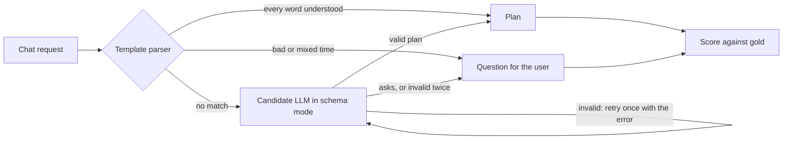

# R-1 Planner LLM: Research & Approach

Oct 28, 2026 · @Paul P · updated Nov 1, 2026 against `main` @ `21ee75c` (v0.1.0). Open PRs #16 (F-06) and #17 (R-4) are noted where they change something.

## TL;DR

R-1 picks the model for the planner's LLM slot. **No model is picked yet, because no candidate has been scored.** This doc settles the shortlist, the request set, the pass/fail rule and the template parser's scope, so the run is the main thing left.

- **Shortlist:** Claude Haiku 5.5, Claude Sonnet 5.5, GPT-6.1 Terra and Gemini 3.8 Flash (hosted); Qwen3.5-4B, Qwen3.5-9B, Gemma 4 E4B and Gemma 4 12B (local, sized to the team's 4 to 16 GB GPUs); Claude Opus 5.5 as the ceiling.
- **Model to beat, as a hypothesis:** Haiku 5.5 as the hosted primary, with Qwen3.5-4B as the offline fallback. The plan is short and schema-constrained, Haiku costs $0.10 / $0.50 per 1M tokens, and it accepted the 5-tool schema in the preflight. Only a scored run can confirm this.
- **Biggest finding:** the shared request set can't compare models yet. Of its 34 requests, the 8 that reach the LLM all expect a question, so no request that expects a plan ever gets there. A broken model would also score 8 of 8, because failing twice ends in a question.
- **Template parser:** keep the scope F-05 built (every word literal, or no match), with one change: "mute it" shouldn't be a whole-clip mute.
- **Blocking the run:** OpenAI and Gemini are out of credits on Paul's keys, and Ollama isn't installed. The benchmark script exists only on the unmerged `paul/r1-planner-llm` branch.

## What R-1 asks for

R-1 picks the LLM behind the planner (F-05), and it is due Tue Nov 3, 2026. F-05's LLM half waits on it.

Scope: an open choice between a hosted model (Anthropic, OpenAI, Google, ...) and an open-weight model on our own hardware. Shortlist a few, compare them on a draft set of about 20 requests shared with F-09, and decide which requests the template parser takes instead of the LLM.

**Exit check (what "done" means):**

- [ ] Script output with plan validity, latency and cost per request for each candidate (for open models, the hardware needed). The script is on `paul/r1-planner-llm`; only a preflight has run.
- [ ] A decisions-log row in `docs/ARCHITECTURE.md`, proposed to the team before it is accepted. Draft below.
- [ ] A write-up in the handoff entry (`/b-handoff`).
- [ ] The planner candidates updated in `README.md` and `docs/ARCHITECTURE.md`. Replacement lines below.

**House rules that apply:** every number comes from a script with the hardware stated. `docs/ROADMAP.md:160` already names Paul as owner, but its branch column is empty.

## What the planner has to do

The planner turns one chat request into one JSON plan, and plain code runs it through the toolbox. The LLM never touches pixels, audio or track ids. So R-1 tests "does the model write a correct plan in one shot", not chat quality or agentic tool use.

**Fixed by the repo** (`docs/ARCHITECTURE.md`, section 2; D-006 and D-016 are still Proposed):

- One LLM call per request writes the whole plan. At Knight Hacks, one plan took 2 to 7 s; calling tools step by step took over 2 minutes.
- An invalid plan is retried once with the error, then the agent asks the user. It never guesses (`_plan_with_llm`, `agent/planner.py:72`).
- The LLM sees text only. PR #17 proposes D-017: text and metadata may go to a cloud LLM, and the planner never sees pixels. So the comparison is text-only.
- The LLM is never on the live per-frame path. It runs once when a standing rule is set.

**What exists today:**

| Piece | State | Where |
| --- | --- | --- |
| Template parser, plan validation, clarify reply | Merged (F-05, PR #15) | `backend/src/vibe/agent/` |
| Plan format | `{step_id, tool, args}`, where `{"$ref": "s1"}` uses an earlier step's result (D-016) | `agent/plan.py` |
| LLM slot | The `LlmPlanner` protocol and the retry are merged, but no model is wired in | `agent/planner.py:37` |
| Tools | Five draft tools: `find_objects`, `resolve_time`, `add_mask`, `cut_range`, `mute` | `agent/tools_draft.py`; PR #16 replaces it with `vibe.toolbox`, same names |
| Request set | 34 requests with gold results, in JSON | `backend/tests/agent/requests_draft.json` |
| Benchmark script | Not on `main`. A prototype is on `paul/r1-planner-llm`, stacked on PR #16, with no team review yet (no PR) | `agent/bench/` on that branch |

**What changed from the first draft of this doc:**

- **The plan is tool calls, not intents.** Knight Hacks' plan held `action`, `effect` and `targets`, and code expanded those into tool calls (`censor/agent/planner.py`). F-05 merged tool calls instead, and D-016 says the template parser and the LLM write the same shape, so the intent-level schema is dropped.
- **Only five tools are real.** Descriptive targets, cut-by-transcript, speakers, denoise, standing rules and undo have no tool yet, so they can't decide R-1. See "Risks".
- **R-3 merged without a VLM,** and PR #17 keeps the planner away from pixels, so the idea of reusing a VLM as the planner is on hold. Knight Hacks' README names only Qwen3-VL-8B, and it appears to have served as the planner too.

## Finding: the shared request set can't compare models yet

The F-05 handoff suggests comparing models on `requests_draft.json`. Routing that file through the parser on `main` shows why that won't work on its own:

| Route on `main` | Gold is a plan | Gold is a question |
| --- | --- | --- |
| Template parser returns a plan | 18 | 0 |
| Parser asks by itself (bad or mixed time) | 0 | 8 |
| Reaches the LLM | **0** | 8 |

Source: the snippet in the appendix, at `21ee75c`, on Windows 11 with Python 3.12.2. No model or GPU is involved.

Two problems follow:

1. **No plan is ever requested from the LLM.** Every request it receives expects a question, so the set says nothing about plan quality.
2. **A broken model scores perfectly.** `Plan.model_validate(raw)` requires `calls` (`agent/planner.py:85`), so the LLM can't ask on purpose. Its only route to a question is two invalid replies, which `_plan_with_llm` turns into a `Clarify`. Scored through `plan_request`, garbage gets 8 of 8.

**Recommendations, neither applied here:** add about 20 requests that reach the LLM and expect plans (next section), and give the reply a `clarify` field so that asking and failing are different outcomes. `paul/r1-planner-llm` has a prototype of both.

## Candidate shortlist

Four hosted candidates (two Claude, one OpenAI, one Google), four local sizes matched to the team's GPUs, and Opus 5.5 as a quality ceiling. Every hosted option supports schema-constrained JSON, so "valid JSON" should be nearly free and the real test is whether the plan is *correct*. Prices and sizes were read from the vendor pages on Nov 1, 2026.

| Candidate | Runs on | Price, input / output per 1M tokens | Est. cost per request\* | Why it's on the list |
| --- | --- | --- | --- | --- |
| [Claude Haiku 5.5](https://platform.claude.com/docs/en/about-claude/pricing) (`claude-haiku-5-5`) | Anthropic API | $0.10 / $0.50 (prompts up to 100k tokens) | \~$0.0006 | Cheapest hosted option on the list, with strict JSON-schema output |
| [Claude Sonnet 5.5](https://platform.claude.com/docs/en/about-claude/pricing) (`claude-sonnet-5-5`) | Anthropic API | $2 / $10 | \~$0.012 | Replaces the repo's stale Sonnet 5 candidate at the same price |
| [GPT-6.1 Terra](https://developers.openai.com/api/docs/models/gpt-6.1-terra) (`gpt-6.1-terra`) | OpenAI API | $1 / $5 | \~$0.006, plus any reasoning tokens | Half the input price of GPT-5.6 Terra ($2 / $12); supports reasoning effort `none` |
| [Gemini 3.8 Flash](https://ai.google.dev/gemini-api/docs/pricing) (`gemini-3.8-flash`) | Google API | $0.75 / $3.75 until Dec 31, 2026, then $1.50 / $7.50 | \~$0.0045 | Has a free tier, but free-tier content may be used to improve Google's products |
| [Qwen3.5-4B](https://ollama.com/library/qwen3.5/tags) (`qwen3.5:4b`) | Every team GPU, tight on the 4 GB RTX 3050; CPU on integrated graphics | $0 (3.3 to 4.0 GB on Ollama) | Hardware only | The local fallback the whole team can run |
| [Qwen3.5-9B](https://ollama.com/library/qwen3.5/tags) (`qwen3.5:9b`) | 8 GB cards: RTX 4060 Ti, RTX 5060 Ti | $0 (6.6 to 7.6 GB on Ollama) | Hardware only | 66.1 on the BFCL-V4 tool-calling benchmark, per [vdf.ai](https://vdf.ai/blog/best-local-llm-by-vram/) (third party, not our number) |
| [Gemma 4 E4B](https://ollama.com/library/gemma4/tags) (`gemma4:e4b`) | 8 GB cards | $0 (6.6 to 9.5 GB on Ollama; the `q4_K_M` build is 6.6 GB) | Hardware only | Already on Paul's disk in LM Studio (`google/gemma-4-e4b`, 6.33 GB per `lms ls`) |
| [Gemma 4 12B](https://ollama.com/library/gemma4/tags) (`gemma4:12b`) | 12 GB and up: Nickolas's 16 GB card, Pablo's Mac, Alex's 5070 if it's 12 GB | $0 (7.7 to 8.0 GB on Ollama) | Hardware only | Best 12 GB pick in the vdf.ai guide; first local candidate to drop if time runs short |
| [Claude Opus 5.5](https://platform.claude.com/docs/en/about-claude/pricing) (`claude-opus-5-5`), ceiling only | Anthropic API | $4 / $20 | \~$0.024 | If the strongest model fails a request, suspect the gold result first |

\*An estimate for budgeting, not a measurement: 4,000 input tokens and 400 output tokens, no caching. Script output replaces it.

**Caching:** cache reads are 0.05x to 0.1x the input price on all five hosted models, but a Claude cache write costs 1.25x and lasts 5 minutes by default. Real planner calls are one per chat message, while a benchmark fires them back to back, so it flatters cached cost. Compare candidates on uncached cost.

**Differences from `candidates.py` on `paul/r1-planner-llm`,** to fix before the first scored run (not done, because this branch is doc-only):

- It lists `gpt-5.6-terra`, not `gpt-6.1-terra`. The rule picks the cheapest model that passes, so the older price could rule out OpenAI on price alone.
- It lacks `qwen3.5:4b`. Without it, the "offline fallback" could be a model most of the team can't run.
- It lacks Gemma 4 E4B, and it has no provider entry for LM Studio.

**Optional extras:**

- **Larger local models,** not re-checked since the first draft: gpt-oss-20b fits Nickolas's card, and Qwen3.6-27B or Qwen3.6-35B-A3B fit Pablo's Mac. They only show how good local can get, because none leaves room for vision models on a team GPU.
- **Cheaper hosted swaps:** [GPT-6 Luna](https://developers.openai.com/api/docs/models/gpt-6-luna) ($0.10 / $0.50, structured outputs supported) ties Haiku on price, so run it if OpenAI credits arrive and Haiku looks like the winner. Gemini 3.5 Flash-Lite ($0.30 / $2.50 in the first draft, not re-checked) is the swap for 3.8 Flash.

## Team hardware and where each local model runs

Five of the eight machines have 8 GB of GPU memory or less, so a local planner the whole team can run is a ~4B model. Unless Qwen3.5-4B scores close to the hosted models, expect a hosted primary (D-002 allows it), with local only as the fallback.

This is as reported on Oct 28. Only Paul's card has been checked since (`nvidia-smi` on Nov 1: RTX 4060 Ti, 8188 MiB, driver 610.60). "Can run" compares Ollama's listed size with available memory, and none of these has been run yet.

| Teammate | GPU or memory | OS | Local candidates it can run | Also has |
| --- | --- | --- | --- | --- |
| Pablo H. | Apple M5 Pro, 64 GB unified memory | macOS | All four, plus the optional Qwen3.6 models | Claude API credits (100) |
| Nickolas G. | [RTX PRO 2000 Blackwell](https://hmc-tech.com/gpu/nvidia-rtx-pro-2000-blackwell), 16 GB | Windows 11 | All four, plus the optional gpt-oss-20b | MDC Makers Space |
| Alex W. | RTX 5070: 12 GB desktop or 8 GB laptop, still unconfirmed | Not given | All four if 12 GB; 4B, 9B and E4B if 8 GB | |
| Paul P. | RTX 4060 Ti, 8 GB | Windows 11 | Qwen3.5-4B, Qwen3.5-9B, Gemma 4 E4B | |
| Jonathan S. | RTX 5060 Ti, 8 GB | Windows | Qwen3.5-4B, Qwen3.5-9B, Gemma 4 E4B | FIU quantum computer, from 2027 |
| Luis P. | [RTX 4050 Laptop](https://www.nvidia.com/en-us/geforce/laptops/40-series/), 6 GB | Windows 11 | Qwen3.5-4B | HiPerGator (UF) |
| Paul A. | RTX 3050, 4 GB | Windows 11 | Qwen3.5-4B at `q4_K_M` (3.3 GB), with a short context | |
| Chris | Integrated graphics | Windows 11 | Qwen3.5-4B on the CPU, slowly | $400 Snowflake credits, $30 Gemini API credits |

- **Paul can run the 8 GB tier.** Gemma 4 12B's 7.7 to 8.0 GB leaves no room for its context on an 8 GB card, so part of it would likely run on the CPU and its latency wouldn't be comparable. That one goes to Nickolas or Pablo.
- **Local runtime:** Ollama isn't installed on Paul's machine (`winget install Ollama.Ollama`). LM Studio is, and its local server may be a shortcut. Whether it enforces a JSON schema is untested, so check that before relying on it.
- **Compare speed within one machine only,** and label every row with its hardware. Pablo's runs use Metal, not CUDA.
- **Blackwell cards need CUDA 12.8+ builds:** Nickolas's RTX PRO 2000, the 5060 Ti and Alex's 5070. The 4060 Ti, the 4050 and the 3050 don't.
- **Credits:** Pablo's Claude credits and Chris's Gemini credits can cover those runs. Nobody on this list has OpenAI credits.
- **This table is useful for F-08's GPU survey,** so share it with Eduardo.

## How to run the comparison

Score every candidate against a hand-written gold result for each request, 5 runs each, from one script that saves raw replies to JSONL in `outputs/r1-planner/` (gitignored). Re-scoring then never costs another API call.

```bash
# on paul/r1-planner-llm, from backend/; this script isn't on main
PYTHONUTF8=1 uv run --group llm --env-file ../.env python -m vibe.agent.bench preflight
PYTHONUTF8=1 uv run --group llm --env-file ../.env python -m vibe.agent.bench run --candidate opus-5-5 --set core --runs 5 --max-usd 10 --network "<your connection>"
uv run python -m vibe.agent.bench report
```



Both routes produce the same plan type, so the parser is scored like the models, as "candidate zero". The bench also runs each LLM on the requests the parser takes, then reports a routed result (the parser where it claims a request, the LLM otherwise).

**1. The plan shape already exists.** The LLM writes D-016's format, and `validate_plan` checks every plan. `ToolCall.args` is `dict[str, Any]` (`agent/plan.py:20`), which strict schema modes can't take, so the schema sent to providers has to be generated from the registry, with one variant per tool. It also has to leave out what [Claude's structured outputs](https://platform.claude.com/docs/en/build-with-claude/structured-outputs) reject: recursion and numeric or length limits. Checks like `targets` having at least one item stay in `validate_plan`. Whether OpenAI, Gemini and Ollama accept the same schema is untested.

**2. Score the 24 requests that reach the LLM.** That's the card's "about 20": 8 from F-05's file plus 16 from `requests_llm.json` on `paul/r1-planner-llm`, all on today's five tools. Jean (F-09) should review these and adopt the format.

| # | Request | Category | A correct result |
| --- | --- | --- | --- |
| 1 | cut it | Should ask | A question |
| 2 | blur him | Should ask | A question |
| 3 | blur the guy in red | Should ask, for now | A question: no tool can check clothing until `check_attribute` exists |
| 4 | blur faces except mine | Should ask, for now | A question, for the same reason |
| 5 | make it nicer | Should ask | A question |
| 6 | remove the people in the background | Should ask | A question: contract v1 has no removal op |
| 7 | trim 0:10 to 0:20 | Should ask | A question: cut this, or keep only this? |
| 8 | mute 0:10 and 0:20 | Should ask | A question: two moments, or a range? |
| 9 | hide everyone's faces in the second half | Paraphrase | Find faces; blur over `resolve_time("second half")` |
| 10 | can you make the license plates unreadable | Paraphrase | Find plates; mask with any effect |
| 11 | black out the people for the last 30 seconds | Paraphrase | Find people; box over `resolve_time("last 30 seconds")` |
| 12 | kill the audio | Paraphrase | Mute the whole clip |
| 13 | get rid of the first ten seconds | Number words | Cut 0 to 10 s |
| 14 | cut from one minute to one fifteen | Number words | Cut 60 to 75 s |
| 15 | silence 1:05 to 1:20, and blur the faces the whole time | Two actions | Mute 65 to 80 s; blur faces for the whole clip |
| 16 | take out 0:10-0:20 and also 1:00-1:10 | Two actions | Two cuts: 10 to 20 s and 60 to 70 s |
| 17 | pixelate faces from 30 seconds in until the end | Time phrasing | Pixelate faces from 30 s to the end |
| 18 | blur faces but only after the 1 minute mark | Time phrasing | Blur faces from 60 s to the end |
| 19 | blurr all the faces pls | Typo | Blur all faces |
| 20 | cut the boring part | Should ask | A question, not an invented timestamp |
| 21 | mute the swearing | Should ask | A question: no transcript tool yet |
| 22 | make the video shorter | Should ask | A question |
| 23 | blur her face | Should ask | A question |
| 24 | remove everyone | Should ask | A question |

The other 26 in F-05's file (18 plans, 8 parser questions) still score the parser. Follow-ups like "now do the same for him" can't be scored, because `LlmPlanner.plan(request, tools, error)` takes no chat history.

**3. Print these per candidate:**

- **Plan validity:** share of replies that parse and validate, on the first try and after the one retry.
- **Plan correctness:** plans compared by what they do: refs followed, `resolve_time` evaluated on a fixed clip length, step names and independent order ignored. A literal 0 to 10 s and `resolve_time("first 10 seconds")` count as the same, which also absorbs PR #16's change to the "first N" gold plans.
- **Unsafe and over-asked counts:** a plan where it should have asked, or any cut the gold result doesn't have, is unsafe. A question where it should have planned is over-asked.
- **Latency:** p50 and p95 wall time, with network and hardware stated. Report the first call separately: Claude compiles a new schema on first use, and local models load into VRAM.
- **Cost per request:** token usage returned by each API times the price table, cached and uncached. For local models: peak VRAM, load time and tokens per second.
- **Consistency:** share of requests where all 5 runs gave the same result.

**4. The decision rule,** fixed on Oct 31 and amended on Nov 1, before any scored run (`agent/bench/__init__.py` on `paul/r1-planner-llm`). Over the core requests, all runs:

1. Zero `unsafe` results, or the fewest if no candidate has zero.
2. Correct within 5 points of the Opus 5.5 ceiling.
3. p95 latency under 5 s.

The cheapest hosted candidate that passes wins. The local model that passes, or comes closest, becomes the offline fallback. A candidate is only compared if it ran exactly what the ceiling ran.

**Decide these before the first scored run,** because changing them afterwards would mean tuning the rule to the results:

| Question | Recommendation | Why |
| --- | --- | --- |
| Do the gates cover all 50 core requests, or the 24 that reach the LLM? | The 24 | 26 of the 50 are the parser's. Over 50, 5 points is 2.5 requests, which is about 10% of what the LLM really handles. `report --requests <file>` drops saved runs outside that file, so a JSON of the 24 should be enough, with no bench change (untested) |
| Does a mask that leaves people visible count as `unsafe`? | Yes | Privacy edits fail closed (`CLAUDE.md`). Masking the wrong half of a clip is only `wrong_plan` today |
| Is "cheapest" cached or uncached? | Uncached | See "Caching" above. `report` prints both, but `decision` uses cached |
| Do requests for future tools run in this pass? | No | The exit check doesn't need them, and Claude rejects the 12-tool schema (see "Results so far") |

**5. Keep it fair:**

- Same system prompt, few-shot examples and schema for every candidate, with no few-shot example in the scored set.
- Each provider's native schema mode: Claude `output_config.format`, OpenAI strict Structured Outputs, Gemini's response schema, Ollama's `format` field.
- Lowest reasoning setting each model allows, with reasoning tokens counted in the cost. Haiku 5.5: thinking `disabled`. Sonnet 5.5: `between_tools`. Opus 5.5 can't turn thinking off, so the ceiling runs at effort `low`. Terra: effort `none`. Flash: its lowest thinking level.
- Temperature stays at each provider's default for everyone, because Claude 5.5 models reject a non-default value.
- Count refusals as their own outcome. Claude can return `stop_reason: "refusal"` from its safety classifiers, and this isn't a request type anyone has checked for false positives.
- Run the Opus 5.5 ceiling first, and fix gold results it "fails" for a good reason. Opus then needs the same 5 runs as everyone else.

**6. Wiring:** one adapter per provider behind F-05's `LlmPlanner.plan(request, tools, error)`, using the official SDKs (`anthropic`, `openai`, `google-genai`) and Ollama's HTTP API, with keys in `.env`. Adapters wrap provider failures in `LlmError`, which the planner turns into a question. OpenRouter is fine for a quality-only pass, but it makes no latency or cost claim, because a proxy adds a hop.

## Which requests the template parser takes

Keep what F-05 built: the parser takes a request only when every word is accounted for, and anything else goes to the LLM. A wrong parse is worse than a few-second LLM call, so the bar is zero wrong parses, with coverage second. The parser uses `fullmatch`, so leftover words mean no match, and Knight Hacks' `NEEDS_LLM` regex isn't needed.

| Template parser takes | LLM takes |
| --- | --- |
| A known noun: faces, people, persons, everyone, everybody, license plates, plates | Any description or pronoun: clothing, position, "him", "faces except mine" |
| An effect word: blur, pixelate, box, black box, and hide (as blur) | Paraphrases, number words and typos: "kill the audio", "the first ten seconds", "blurr" |
| Explicit times: "0:10 to 0:20", "after 1:30", "the first 5 seconds", "first half", "for the whole video" | Content references: "where he talks about...", "the boring part" |
| Mute or silence, with or without a time | Speaker targets: "mute the guy on the right" |
| Cut, remove or delete, only with a time | Anything with no template yet: undo, redo, denoise, standing rules |
| Two or more literal actions joined by "and", "then" or commas | Anything vague |

**The parser asks by itself, with no LLM,** in three cases: bare numbers ("cut 10 to 20"), backwards ranges ("mute 0:20 to 0:10"), and requests where only part has a time ("blur faces and mute 0:10 to 0:20").

**What changed from the first draft:** two-action requests stay with the parser when each clause is literal; undo, redo and denoise aren't templates; and "screens" and "text" aren't nouns.

**What the data says so far:** the parser takes 26 of the 34 requests and gets all of them right (`test_planner.py`, 150 agent tests passed at `21ee75c`, Windows 11, Python 3.12.2). That's weak evidence, because the set was written alongside the parser. On 23 extra requests probed by hand (negation, exclusions, pronouns, new phrasings), it took 9. "don't blur faces" and "blur everyone but me" correctly went to the LLM. The candidate-zero line in `report` should be run again on the full set.

**One recommended change:** the mute template accepts "it" (`_MUTE`, `agent/templates.py:28`), so "mute it" and "silence it" become a whole-clip mute. No test covers this. Pronouns are the LLM's job everywhere else in the parser, and it matters more once chat history exists: "mute it" after talking about one speaker would silence everyone. The fail-safe table says to ask when the target speaker is ambiguous. **Pablo** owns this file, so raise it on the F-05 follow-up.

## Results so far

Nothing here picks a model.

**Preflight** (`python -m vibe.agent.bench preflight` from `paul/r1-planner-llm`, Nov 1, Windows 11 with an RTX 4060 Ti 8 GB; network not recorded; raw output in `outputs/r1-planner/preflight-20261101T205743Z.txt`, on Paul's machine only). Times are one cold first call each, not scored results.

| Candidate | Model found | 5-tool schema | 12-tool schema |
| --- | --- | --- | --- |
| `opus-5-5` | Yes | Accepted, 4.30 s, $0.02556 | Rejected |
| `sonnet-5-5` | Yes | Accepted, 3.29 s, $0.01267 | Rejected |
| `haiku-5-5` | Yes | Accepted, 1.54 s, $0.00064 | Rejected |
| `gpt-5.6-terra` | Yes | Not tested: 429, no credits | Not tested |
| `gemini-3.8-flash` | Yes | Not tested: 402, credits used up | Not tested |
| `qwen3.5-9b`, `gemma4-12b` | Not tested | Ollama not running | Not tested |
| `openrouter-qwen3.5-9b` | Yes | Accepted, 2.54 s | Accepted, 1.90 s |

- **Tokens:** Claude used about 4,480 prompt tokens and 148 to 159 output tokens per call. Qwen through OpenRouter reported 1,380 and 194. The cause of the prompt gap is unknown. "Accepted" on OpenRouter only means no error came back.
- **Claude rejects the 12-tool schema.** All three models returned "The compiled grammar is too large, which would cause performance issues." This doesn't block R-1, which only needs five tools. Where the limit falls between 5 and 12 tools is unknown, so it matters to whoever grows the toolbox: past that point, Claude needs a looser schema with `validate_plan` doing more of the work.

## What gets built after the pick

This is the F-05 LLM half, which R-1 only recommends. `paul/r1-planner-llm` has prototypes of all four, unmerged and with no team review yet (no PR).

| Piece | Today on `main` | To build |
| --- | --- | --- |
| Let the LLM ask | The reply must have `calls` (`agent/planner.py:85`) | A `clarify` field, with no retry when it's set |
| Reply schema | `ToolCall.args` is an open dict | One schema generated from the registry, one variant per tool |
| Provider adapter | Protocol only (`LlmPlanner`, `LlmError`) | An adapter for the winner and one for the fallback |
| Prompt | None. `ToolSpec` has no description until PR #16 | Built from the registry, plus few-shot examples |

## Plan to Nov 3

Two days are left, so the order puts what can run today first.

**Sun Nov 1 (tonight)**

- [ ] Settle the four questions under "Decide these before the first scored run"
- [ ] Post in the team chat: Chris for Gemini credits, anyone for OpenAI credits, Nickolas or Pablo for a Gemma 4 12B run, Jean to review the 24 requests
- [ ] Install Ollama, or check that LM Studio's server enforces a schema; pull Qwen3.5-4B and 9B
- [ ] On `paul/r1-planner-llm`, apply the `candidates.py` changes above

**Mon Nov 2**

- [ ] Preflight the untested candidates. If any rejects a property named `$ref`, rename it for all of them (`WIRE_REF_KEY` on that branch), so the comparison stays fair
- [ ] Run the Opus 5.5 ceiling once, and fix the gold results it exposes
- [ ] Run Opus, Haiku and Sonnet, 5 runs each. These only need the Anthropic key that already works
- [ ] Run Terra and Flash once credits arrive, then Qwen3.5-4B, 9B and Gemma 4 E4B on the 4060 Ti, labelled as such

**Tue Nov 3 (due)**

- [ ] Print the report; post the decision row to the team as a proposal
- [ ] Update `README.md` and `docs/ARCHITECTURE.md`, write the handoff, add the branch to `docs/ROADMAP.md:160`, and open the PRs
- [ ] Fold in team feedback; the card is marked done once the row is agreed

**If time or credits run short,** drop in this order: Gemma 4 12B, Gemma 4 E4B, the consistency metric, and Sonnet if Haiku passes every gate. Never drop the 24 requests, candidate zero, the Opus ceiling, Haiku or Qwen3.5-4B. If OpenAI or Gemini credits don't arrive, run them through OpenRouter as quality-only and say in the decision row that their latency and cost weren't measured.

## Decision row draft, doc edits and risks

A fill-in-the-blanks row for `docs/ARCHITECTURE.md`. Main has D-015 and D-016, and PR #17 claims D-017 and D-018, so this is **D-019** if #17 merges first. Check before the PR.

```markdown
| D-019 | <date> | Planner LLM: <winner> (`<model id>`), schema-constrained JSON output, behind a provider adapter; <local model> as the offline fallback. Template parser takes literal requests only (fixed nouns, explicit times, mute or silence, cuts with a time) | Proposed | <validity %>, <correctness %>, <unsafe count>, p50/p95 <latency>, <$ per request> from `python -m vibe.agent.bench report` on <hardware, network>, <N> requests x 5 runs. Covers today's five tools only; re-check when `check_attribute` and chat history land |
```

**Also for the team:** D-016 asks to be confirmed "with the F-06 owner and R-1". R-1 can confirm it: all three Claude models and Qwen returned that shape in the preflight. OpenAI, Gemini and local models haven't been tested with a property named `$ref`, so that check comes first.

**Replacement lines, to apply once the row is agreed** (line numbers on `main`; PRs #16 and #17 move the later ones, so find them by their text):

- `README.md:135`: `| Agent / planner LLM | **Proposed (D-019):** <winner>; <local model> as the offline fallback | Cloud allowed (hybrid); text and metadata only; JSON plan checked by validate_plan |`
- `docs/ARCHITECTURE.md:40`: change `(candidate: Claude)` to `(D-019: <winner>, with <local model> offline)`
- `docs/ARCHITECTURE.md:41`: remove `which LLM;` from the open list
- `docs/ARCHITECTURE.md:261`: `- Planner LLM: see D-019. Re-check the pick when check_attribute and chat history land.`

**Risks and what to do about them:**

- **The decision covers only today's five tools.** Descriptive targeting ("the guy in the red hoodie") is a Must feature and the hardest planning case, and it can't be scored until its tools exist. A cheap model could pass now and struggle there, so keep the adapter swappable and re-run when `check_attribute` lands.
- **R-1 compares single requests.** Follow-ups and reacting to tool results aren't tested, because the planner takes no history and no executor exists yet.
- **The numbers depend on an unmerged branch.** The script is stacked on PR #16, and the exit check needs it to be reproducible. Keep this doc's PR separate, and open the bench's PR after #16 merges or stacked on it.
- **The same person wrote the requests and the gold results.** Ask Jean or another teammate to review them before the hosted runs.
- **Claude's schema limit.** The toolbox will reach it as it grows, somewhere between 5 and 12 tools with a one-variant-per-tool schema.
- **Data policy is only proposed (PR #17).** Hosted candidates see text only. Gemini's free tier may use that content to improve Google's products, so use a paid key or name that in the decision.
- **Prices move.** Gemini 3.8 Flash doubles on Jan 1, 2027, so check it against the semester before calling it cheapest.
- **Hidden reasoning tokens.** Set reasoning to the lowest level and count those tokens, or a "cheap" model can come out slower and pricier.
- **Tool descriptions reach the LLM word for word.** PR #16's `find_objects` description includes "Stub: filters the given tracks.", so numbers only hold for the descriptions they ran with.
- **Three team cards are Blackwell.** Local runtimes need a CUDA 12.8+ build (`docs/ARCHITECTURE.md`, Compute), so Nickolas should check his build before running.
- **VRAM is shared.** On the team's 8 GB cards, a resident 9B planner leaves almost no room for the vision models, so record that as a cost of the local option, not just $0.
- **API budget.** 5 runs of 50 requests is 250 calls per hosted candidate, about $12 in total at the estimates above, before caching and retries. The 24 alone is about $6. The preflight cost about $0.04 on Claude by the script's price table.

## Appendix: the routing count

Run from `backend/`, on `main`. It only reads files and doesn't call the network.

```python
import json
from collections import Counter
from vibe.agent.templates import parse
from vibe.agent.timeparse import TimeParseError

def route(text):
    try:
        return "template" if parse(text) else "reaches the LLM"
    except TimeParseError:
        return "parser asks"

requests = json.load(open("tests/agent/requests_draft.json"))["requests"]
print(Counter((route(r["request"]), r["expect"]) for r in requests))
```

Output at `21ee75c`: `{('template', 'plan'): 18, ('reaches the LLM', 'clarify'): 8, ('parser asks', 'clarify'): 8}`. Run on `requests_llm.json`, the same function sends all 16 core requests to the LLM.

**The 23 probes, through the same `parse()`.** The parser took: mute it, silence it, mute the video, "blur faces, pixelate plates" (one request), hide the plates, pixelate everyone, cut the first half, remove the second half, box faces after 1:30. Sent to the LLM: cut that, blur them, don't blur faces, do not mute 0:10 to 0:20, blur everyone but me, blur faces but not mine, blur everyone except me from 0:10 to 0:20, blur all the people in the video, undo, undo that, remove the background noise, denoise the audio, unmute the audio, from now on only I am visible.

## Sources

Vendor pages were read on Nov 1, 2026.

- [R-1 card on Trello](https://trello.com/c/N0JqKciB) and the team repo [AlexWS12/build2026fall](https://github.com/AlexWS12/build2026fall): `docs/ARCHITECTURE.md`, `docs/ROADMAP.md`, `README.md`, `CLAUDE.md`, `backend/src/vibe/agent/`, the F-05 and R-3 handoffs, PR #16 and PR #17, and the branch `paul/r1-planner-llm`
- Reference MVP [Edugre/KnightHacks-26](https://github.com/Edugre/KnightHacks-26): `README.md`, `censor/agent/planner.py`, `censor/agent/agent.py`
- [Claude pricing](https://platform.claude.com/docs/en/about-claude/pricing) and [Claude structured outputs](https://platform.claude.com/docs/en/build-with-claude/structured-outputs)
- [GPT-6.1 Terra](https://developers.openai.com/api/docs/models/gpt-6.1-terra), [GPT-5.6 Terra](https://developers.openai.com/api/docs/models/gpt-5.6-terra) and [GPT-6 Luna](https://developers.openai.com/api/docs/models/gpt-6-luna) model pages
- [Gemini Developer API pricing](https://ai.google.dev/gemini-api/docs/pricing)
- Ollama tags for [qwen3.5](https://ollama.com/library/qwen3.5/tags) and [gemma4](https://ollama.com/library/gemma4/tags)
- [Best local LLM by VRAM (vdf.ai, Oct 6, 2026)](https://vdf.ai/blog/best-local-llm-by-vram/), third party
